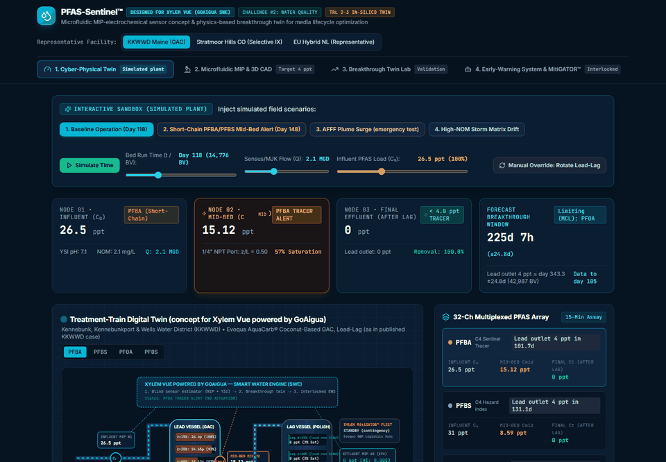
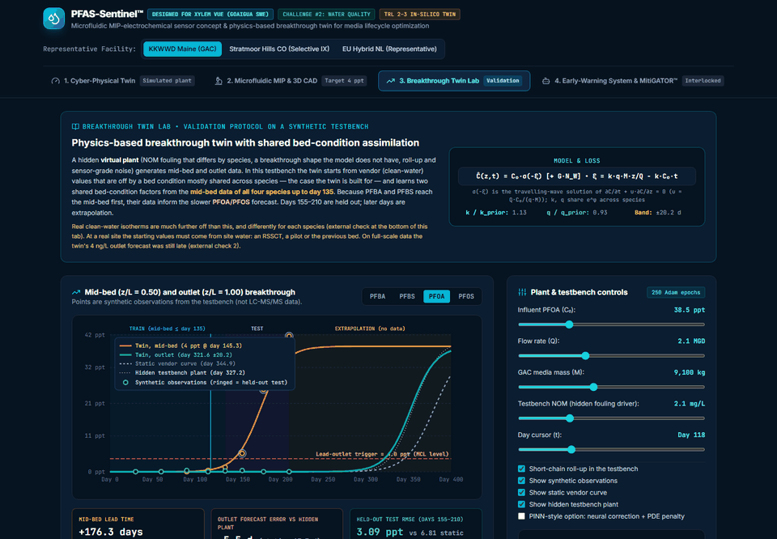
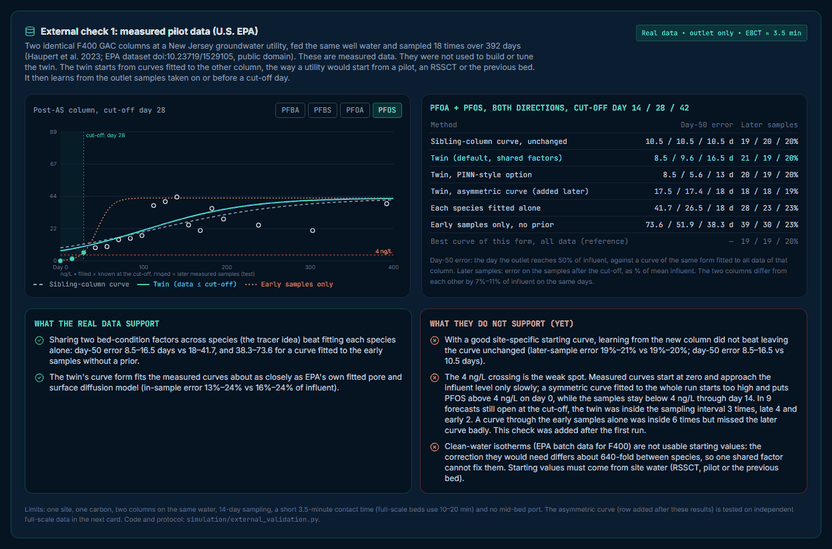
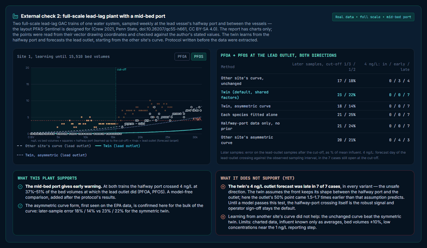
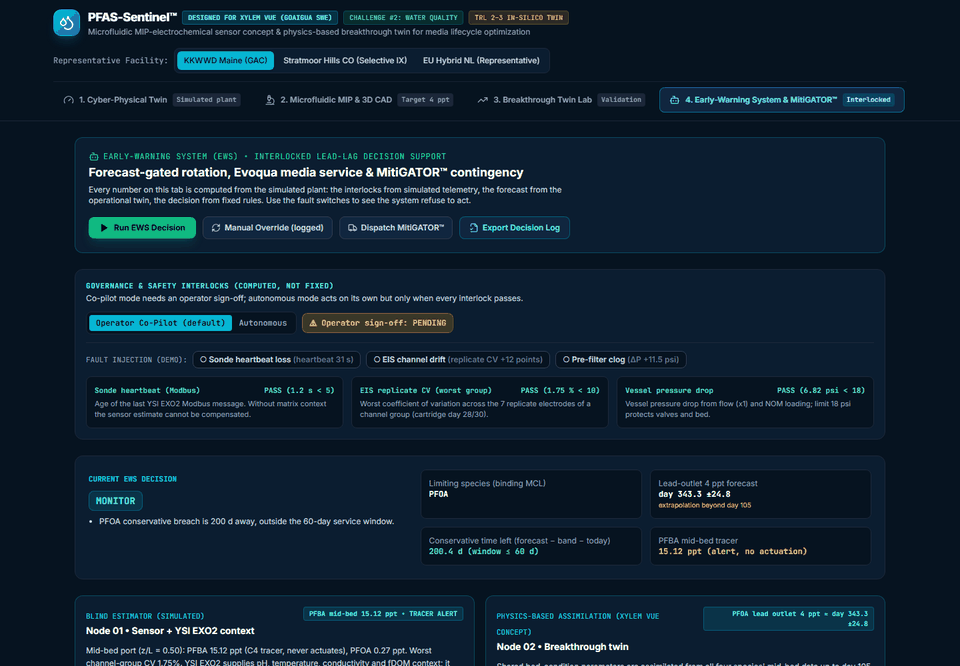
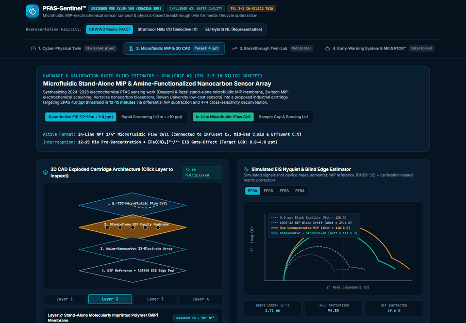
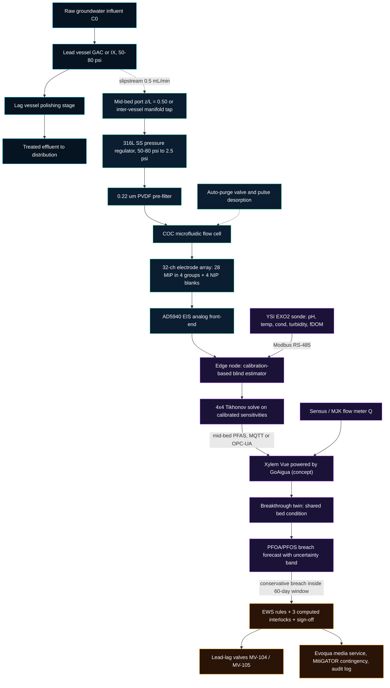
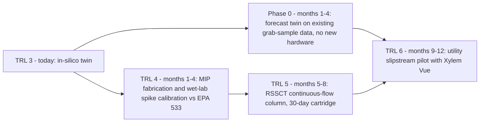

# PFAS-Sentinel™ | Mid-Bed MIP Sensing & a Physics-Based Breakthrough Twin

**Challenge #2: Water Quality — Xylem Global Student Innovation Challenge 2026**  
**Technology Readiness Level:** TRL 2–3 (numerical proof of concept on a synthetic testbench, plus checks of the twin on two public measured datasets)  
**Target platform (concept):** Xylem Vue powered by GoAigua & Evoqua media service  
**Stack:** TypeScript / React 18 / Vite / Tailwind CSS · Python 3.8+ (standard library only) · [MIT License](LICENSE)

[](#6-technology-readiness-level--in-silico-disclosure)
[](#5-regulatory-positioning)
[](#5-regulatory-positioning)
[](LICENSE)

**🔗 Live interactive demo:** https://yserhattemel.github.io/pfas-sentinel/ · New to the terminology? See [Key terms, explained](#key-terms-explained).

| [](https://yserhattemel.github.io/pfas-sentinel/?tab=twin) | [](https://yserhattemel.github.io/pfas-sentinel/?tab=pinn) |
| :---: | :---: |
| **1. Plant twin** — simulated lead-lag train, mid-bed tracer, final-effluent screen | **3. Breakthrough Twin Lab** — validation protocol on the synthetic testbench |
| [](https://yserhattemel.github.io/pfas-sentinel/?tab=pinn#external-check) | [](https://yserhattemel.github.io/pfas-sentinel/?tab=pinn#fullscale-check) |
| **External check 1** — measured EPA pilot data (Section 3.8.1) | **External check 2** — full-scale plant with a mid-bed port (Section 3.8.2) |
| [](https://yserhattemel.github.io/pfas-sentinel/?tab=agentic) | [](https://yserhattemel.github.io/pfas-sentinel/?tab=biosensor) |
| **4. Early-warning system** — computed interlocks, co-pilot sign-off, audit log | **2. Sensor concept** — MIP array, calibration-based blind estimator |

*Screenshots of the live demo; click one to open that tab. The [Impact & ROI tab](https://yserhattemel.github.io/pfas-sentinel/?tab=business) ([screenshot](docs/screenshots/07-impact.png)) holds the economics, roadmap and pitch script.*

> [!NOTE]
> PFAS-Sentinel is an independent student project. It is designed for compatibility with Xylem products (Xylem Vue, YSI EXO2, Sensus, Evoqua, MitiGATOR™), but it is not developed, endorsed, or validated by Xylem Inc. All trademarks belong to their respective owners.

> [!IMPORTANT]
> **Every number in this README comes from simulation, except Section 3.8.** A hidden "virtual plant" generates the data; the twin and the sensor estimator never see its parameters. No physical sensor has been built. Section 3.8 is the only part that uses measured data: the twin, unchanged, on a public U.S. EPA pilot dataset and on a full-scale lead-lag plant with a mid-bed port — with mixed results that are reported in full. Figures are reproduced by `python simulation/validation_report.py` , `python simulation/external_validation.py` and `python simulation/external_validation_fullscale.py`, and checked by the test suites (CI recomputes every number).

### How PFAS-Sentinel addresses the judging criteria
| Criterion | Where to look |
| :--- | :--- |
| **Impact** — meaningfulness & reach | In-silico decision test and economics with sensitivity and US market size ([Sections 3.5](#35-results-on-the-testbench) and [8](#8-municipal-economic--environmental-model)) |
| **Challenge Fit & Feasibility** — Water Quality, real-world path | Retrofit onto existing vessel ports ([Section 4](#4-hardware-hydraulic-interfacing--durability)); interlocked, logged control ([Section 3.7](#37-early-warning-decision-and-safety-interlocks)); checks on two public measured datasets, weaknesses included ([Section 3.8](#38-external-checks-on-measured-data)); TRL 2–3 disclosure and 12-month roadmap with a software-first Phase 0 ([Section 6](#6-technology-readiness-level--in-silico-disclosure)) |
| **Innovation** — originality | Mid-bed PFBA/PFBS as early tracers that teach the twin the bed's condition, so PFOA/PFOS forecasts improve before PFOA/PFOS themselves move ([Section 3](#3-model-and-methods)) |
| **Ecosystem fit** — how it plugs into Xylem | One sensor pod + one twin, designed around six existing Xylem/Evoqua offerings ([table below](#xylem-ecosystem-integration)) |

### Xylem ecosystem integration
PFAS-Sentinel adds the one missing signal (in-bed PFAS) to equipment and services Xylem already sells. These are **design targets**: the prototype has no live connection to any Xylem system.

| Xylem offering | Role in PFAS-Sentinel | Interface (designed) | Data / action | Status in prototype |
| :--- | :--- | :--- | :--- | :--- |
| **YSI EXO2** sonde | Matrix context for the sensor estimator; it does not measure PFAS | Modbus RS-485 via the [EXO Modbus Signal Output Adapter](https://www.ysi.com/product/id-599825/EXO-Modbus-Signal-Output-Adapter) | pH, temperature, conductivity, turbidity, fDOM | Simulated sonde readings |
| **Sensus / MJK** flow metering | Flow $Q$, the main driver of the mass-transfer-zone speed | Plant SCADA historian | Flow rate → twin input | Slider in the demo |
| **[Xylem Vue powered by GoAigua](https://www.xylem.com/en-ie/brands/xylem-vue/smart-water-simplified/)** | Would host the twin, dashboards and the rotation rule | MQTT / OPC-UA | Breakthrough forecast ± band, alerts, audit log | Runs in the browser demo |
| **Evoqua** GAC / selective IX vessels | The treatment asset being monitored (lead-lag trains) | Existing `1/4" NPT` sample ports | Mid-bed and inter-vessel slipstream | Representative profiles |
| **Evoqua** media service | Media changeout set by forecast instead of calendar | Work order from the EWS | Service date | Logged work order (demo) |
| **Evoqua [MitiGATOR™](https://www.xylem.com/en-uk/Catalog/products--services/services/temporary-water-treatment/mitigator-mobile-system/)** mobile system | Contingency if a breach is closer than the service lead time | Rental dispatch | Trailer with 6 carbon/resin vessels, up to 1,000 gpm | Logged dispatch (demo) |

**Open standards, no lock-in.** Every designed link uses Modbus, MQTT or OPC-UA, and Xylem Vue itself ingests data from non-Xylem sources.

**An operator's view (representative KKWWD-type GAC vessel, simulated)**

| Day | What happens | Who / where |
| :--- | :--- | :--- |
| 0 | Fresh media; the twin starts from the design curve (here vendor values; at a real site an RSSCT in site water, a pilot or the previous bed, see Section 3.8) | Twin |
| ~93 | PFBA crosses 4 ppt at the mid-bed port → **tracer alert**. No valve moves. | Sensor → operator notification |
| every 15 days | A new mid-bed data point (all four PFAS) is assimilated; the PFOA/PFOS forecast tightens | Twin |
| 256 | Conservative PFOA forecast (≈ day 328 minus its ±12-day band) enters the 60-day service window → EWS proposes rotation; all interlocks pass; operator signs off (co-pilot mode) | EWS → Evoqua work order |
| 327 | The lead-vessel outlet would reach 4 ppt PFOA (hidden plant). Rotation came 71 days earlier; the lag vessel still protects the final effluent | Plant PLC |
| quarterly | Certified LC-MS/MS confirms compliance at the final effluent | Accredited lab |

A static vendor curve would have proposed the same rotation on day 285, only 42 days before the breach — inside the service lead time.

---

## 1. Executive Summary

### Problem
Utilities removing PFAS ("forever chemicals") with granular activated carbon (GAC) or selective ion exchange (IX) cannot see inside their vessels between lab samples:

- **Laboratory latency:** compliance monitoring uses LC-MS/MS (US EPA Methods 533 / 537.1); the project assumes **10–14 days** turnaround and **\$300–\$500 per sample** (to be confirmed with labs and utilities).
- **No forecast:** the mass-transfer zone (MTZ) moves through the bed unseen. Short-chain PFAS (**PFBA**, **PFBS**) arrive first and can be pushed back off the carbon (effluent briefly above influent).
- **Conservative changeout:** without a forecast, media is changed on cautious schedules. Our **working hypothesis** is that 20–30% of usable capacity is discarded; the business case breaks even at only 6% (Section 8.1).

### Solution
1. **In-line MIP sensor pod (concept)** on the existing `1/4" NPT` mid-bed port: 28 molecularly imprinted electrodes in four species groups + 4 non-imprinted blanks, with YSI EXO2 matrix context.
2. **Physics-based breakthrough twin:** the travelling-wave solution of the advection-sorption equation with two **bed-condition factors shared by all four PFAS**, so early PFBA/PFBS data sharpen the PFOA/PFOS forecast. A PINN-style neural correction is available as an option.
3. **Interlocked early-warning system:** rotation only when the conservative PFOA/PFOS forecast enters the service window and three computed interlocks pass; every action is logged.

### What the simulation shows (details in Section 3.5)
| Question | Result on the synthetic testbench |
| :--- | :--- |
| Does sharing the bed condition help? | PFOA/PFOS breach-day error **17.0 days** (joint) vs **49.2** (each species alone) vs **53.6** (vendor curve), 16 random plants |
| Is the rotation timely and safe? | Rotation a median **75 days** before the PFOA/PFOS lead-outlet breach (range 69–95; target 60), **never after it**, in 15 plants; a vendor curve was late in **7 of 15** |
| Is the uncertainty band honest? | Nominal 95%; **91%** coverage on held-out synthetic plants (67% without the model-form term) |
| Does the 4×4 deconvolution matter? | Random mixtures: **21%** mean error with it, **76%** without |

**Checks on measured data (Section 3.8):**
- *Supported:* at a full-scale lead-lag plant the **mid-bed (halfway) port crossed 4 ng/L at 37–51% of the lead outlet's bed volumes** for PFOA/PFOS — real early warning. Sharing the bed condition across species beat fitting each species alone on EPA pilot data (day-50 error **8.5 vs 41.7 days**), and an asymmetric curve form cut the full-scale forecast error from 22–23% to 14–18%.
- *Not yet supported:* the twin's forecast of the lead-outlet 4 ng/L crossing was **late in 7 of 7** full-scale cases, it did not beat a good site-specific starting curve, and clean-water isotherms are unusable as starting values. These are the next things to fix.

### Modeled economics (6-vessel plant, assumptions in Section 8)
| Metric | Value |
| :--- | :--- |
| Net annual utility savings (if 28% bed-life extension) | **\$112,092 / yr** |
| Break-even bed-life extension | **6.0%** |
| Spent media avoided / CO₂e avoided | **15.3 t / yr** / **36.7 tCO₂e / yr** |
| Disposable cartridge / reader pod target BOM | **\$11.80** / **\$148.00** |

### Key terms, explained
The project uses specialist vocabulary from water treatment, electrochemistry and machine learning. Rather than drop the precise terms, each one is explained below — what it is, and why it matters for PFAS-Sentinel. The same glossary opens from the **Key Terms** button in the live demo.

<!-- GLOSSARY:START -->
**Water treatment**

| Term | What it is | Why it matters here |
| :--- | :--- | :--- |
| **PFAS (short-chain C4 vs long-chain C8)** | Per- and polyfluoroalkyl substances, "forever chemicals". The number is the length of the carbon chain: PFBA/PFBS have 4 carbons, PFOA/PFOS have 8. | Short chains stick to carbon weakly and move through the filter first; long chains stick strongly and are the ones the US limit (4 ppt) targets. |
| **GAC / Selective IX** | Granular activated carbon and selective ion-exchange resin: the two main media used in pressure vessels to remove PFAS from drinking water. | Both get "used up" over time and must be replaced; replacing too early wastes money and creates hazardous waste. |
| **Lead-lag train** | Two vessels in series. The lead vessel does most of the work; the lag vessel polishes and acts as a safety barrier. | When the lead vessel is spent, valves swap the roles and only the lead media is replaced. Timing this swap is the decision PFAS-Sentinel supports. |
| **Mid-bed port (z/L = 0.50)** | A sampling tap halfway down the vessel. z is the depth from the top, L the total bed depth, so z/L = 0.50 is the middle. | Contaminants reach the middle months before the outlet, so a reading here is an early look at what the outlet will see later. |
| **Mass Transfer Zone (MTZ)** | The band of media that is actively adsorbing. Above it the media is saturated; below it the media is still clean. | The MTZ moves down the bed like a slow wave. Tracking its position is what lets the twin forecast when the outlet will exceed the limit. |
| **Breakthrough & Bed Volumes (BV)** | Breakthrough is when a contaminant starts appearing at the outlet. One bed volume is the amount of water equal to the volume of the media bed. | Bed volumes let results from columns of different sizes be compared; the literature reports PFAS breakthrough in BV. |
| **Chromatographic roll-up (Cₜ > C₀)** | Strongly held long-chain PFAS push weakly held short-chain PFAS back off the carbon, so the outlet can briefly carry more short-chain PFAS than the inlet. | Grab samples taken every few weeks can miss these spikes completely; continuous mid-bed data can see them coming. |
| **MCL / Hazard Index** | Maximum Contaminant Level: the legal limit in drinking water (4.0 ppt for PFOA and PFOS in the US). The Hazard Index is a combined score for a PFAS mixture. | EPA has proposed to keep the PFOA/PFOS MCLs and rescind the Hazard Index (not final as of September 2026), so PFOA/PFOS are the targets that drive actuation in this design. |
| **LC-MS/MS (EPA Method 533 / 537.1)** | Liquid chromatography with tandem mass spectrometry: the certified laboratory method for measuring PFAS at parts-per-trillion levels. | It is accurate but slow and costly (the project assumes 10–14 days and $300–$500 per sample, to be confirmed with labs). PFAS-Sentinel keeps it for compliance and adds continuous data in between. |
| **RSSCT** | Rapid Small-Scale Column Test: a lab column filled with crushed media that reproduces months of full-scale operation in days or weeks. | It is the planned TRL 5 step for testing the sensor cartridge and the twin on real breakthrough curves without a full-scale plant. |

**Sensor**

| Term | What it is | Why it matters here |
| :--- | :--- | :--- |
| **MIP / NIP** | A molecularly imprinted polymer has cavities shaped like the target molecule, so PFAS fit in and most other molecules do not. A non-imprinted polymer (NIP) is the same material without the cavities. | The NIP picks up everything except specific PFAS binding, so subtracting NIP from MIP removes background signal from organic matter and salts. |
| **EIS & ΔRct** | Electrochemical impedance spectroscopy measures how easily charge passes through the electrode surface. Rct is the charge-transfer resistance. | When PFAS fill the MIP cavities they block a redox probe, Rct rises, and that change (ΔRct) is converted into a concentration. |
| **4×4 Tikhonov deconvolution** | A matrix calculation that separates four overlapping signals (PFBA, PFBS, PFOA, PFOS), because each sensor channel responds a little to all four. Tikhonov regularization keeps the answer stable when the data is noisy. | Without it, a high PFOS level could be misread as PFOA, which would distort the forecast. |
| **fDOM / NOM** | Natural organic matter (NOM) is dissolved material from soil and plants. fDOM is its fluorescent part, measured optically by the YSI EXO2 sonde. | NOM competes with PFAS for carbon and fouls sensors; the fDOM reading lets both the sensor and the twin correct for it. |
| **Debye length** | The thin layer near a charged surface where ions in the water screen the charge (Gouy-Chapman theory). It shrinks as the water gets saltier. | It changes how strongly charged PFAS are attracted to the electrode, so the edge estimator corrects for conductivity (learned from calibration runs). |

**Digital twin & business**

| Term | What it is | Why it matters here |
| :--- | :--- | :--- |
| **Breakthrough twin (and the PINN-style option)** | The twin uses the travelling-wave (Thomas) solution of the 1D advection-sorption equation and learns two bed-condition factors (capacity and kinetics) shared by all four PFAS. A physics-informed neural network (PINN-style) correction was also built and tested. | Sharing the bed condition lets early PFBA/PFBS data sharpen the PFOA/PFOS forecast (the biggest gain in the ablation). The PINN-style correction helps only with the PDE penalty and gives a small further gain on the testbench, so it is offered as an option; the 2-parameter model stays the default for decisions. |
| **Uncertainty band (±days)** | Parameter uncertainty plus a model-form term that grows with the distance from the last data point. Nominal 95%; on held-out synthetic plants it covered the true breach about 91% of the time. | Actuation uses the early end of the band (breach day minus band), so uncertainty makes the system act earlier, not later. It is a decision aid, not a certified interval. |
| **Early-warning system (EWS) and interlocks** | Software steps that read data, forecast, decide and prepare actions (valve rotation, service order). Three computed interlocks (sonde heartbeat, electrode agreement, pressure drop) and operator sign-off must pass before anything moves; every action is logged. | It turns a forecast into a scheduled action instead of a chart someone must remember to check. |
| **Servitization** | Selling an outcome as a service (here a per-vessel subscription with cartridges included) instead of selling equipment up front. | Utilities avoid capital cost and pay from the media savings; Xylem gains recurring revenue alongside Evoqua media service. |
| **TRL (Technology Readiness Level)** | A 1–9 scale of maturity: TRL 3 is a proof of concept, TRL 4 lab validation, TRL 5 validation in a relevant environment, TRL 6 a prototype demonstrated in that environment. | PFAS-Sentinel is at TRL 2–3 (simulation); the 12-month roadmap targets TRL 6. |
<!-- GLOSSARY:END -->

---

## 2. System Architecture



---

## 3. Model and Methods

### 3.1 The synthetic testbench ("virtual plant")
The data that the twin learns from are generated by a hidden plant (`truthConcentration` in [`src/data/hybridTwin.ts`](src/data/hybridTwin.ts)) that differs from the model on purpose:

- **NOM fouling** lowers capacity and speeds kinetics, more strongly for short chains (species-specific exponents);
- the **breakthrough shape** is a Richards curve ($\nu = 0.7$), not the model's Thomas logistic;
- short-chain **roll-up** (effluent above influent) is added near saturation;
- **sensor-grade noise** (15% relative + 0.2 ppt), matching the sensor benchmark in 3.6.

Facility profiles are representative, not utility data (Section 6).

### 3.2 Breakthrough twin
Along bed depth $z$ (in vessel lengths; the lag vessel is $z \in [1, 2]$) the twin uses the travelling-wave (Thomas) solution of the advection-sorption equation

$$\frac{\partial C}{\partial t} + u\,\frac{\partial C}{\partial z} = 0,\qquad u = \frac{Q\,C_0}{q\,M},\qquad
\frac{\hat C_s(z,t)}{C_{0,s}} = \sigma(-\xi_s),\quad \xi_s = \frac{k_s\, q_s\, M\, z}{Q} - k_s\, C_{0,s}\, t$$

with $k_s = k_{\text{prior},s}\,e^{\varphi_K}$ and $q_s = q_{\text{prior},s}\,e^{\varphi_Q}$. The two **bed-condition factors** $\varphi_K, \varphi_Q$ are shared by PFBA, PFBS, PFOA and PFOS. Because PFBA/PFBS reach the mid-bed months before PFOA/PFOS, their data fix the bed condition early — the sentinel-tracer idea, made quantitative.

**PINN-style option.** A 4-unit neural correction $\hat C = C_0[\sigma + G\,\mathcal N_W(z, t, \sigma)]$, $G = \sigma(1-\sigma)$, can be switched on in the Twin Lab. It is trained with separately squared advection and kinetic residuals at 48 collocation points.

### 3.3 Training
$$\mathcal L = \frac1n\sum_i\Big(\frac{\hat C_i - y_i}{C_{0,i}}\Big)^2 + \lambda_{\text{adv}}\,\overline{r_{\text{adv}}^2} + \lambda_{\text{kin}}\,\overline{r_{\text{kin}}^2} + \lambda_{\text{prior}}(\varphi_K^2+\varphi_Q^2) + \lambda_W\lVert W\rVert^2$$

$r_{\text{adv}}$ and $r_{\text{kin}}$ are central finite-difference residuals of the advection equation and of the Thomas rate law, squared separately so they cannot cancel. The gradient of the whole loss is derived analytically and **checked against central finite differences** in both test suites. Adam, 250 epochs; the bed-condition factors have a weak prior (±25%) centred on the vendor values — not on the testbench's hidden values. In the default (physics-only) model the PDE residual is zero by construction (RMS < 1e-4).

**Validation protocol:** train on mid-bed data of all four species up to day 135; test on unseen days 155–210 (mid-bed and outlet); later days are **extrapolation** and are shaded as such in the demo. **Operational mode** (Twin and EWS tabs): one mid-bed data point every 15 days, and the twin only uses data up to "today".

### 3.4 Uncertainty band
$$\text{band} = 1.96\sqrt{\sigma_{\text{param}}^2 + (0.05\,d)^2} + 0.5\ \text{days}$$

$\sigma_{\text{param}}$ comes from the delta method on the posterior of $(\varphi_K, \varphi_Q)$; $d$ is the distance in days from the last data point to the forecast. The model-form coefficient 0.05 was calibrated on one set of 16 synthetic plants (93.8% coverage) and checked on a different set: **90.6%** coverage (nominal 95%). Without the model-form term coverage drops to 67.2%. The band is a decision aid, not a certified interval. Rotation uses the early end (forecast − band).

### 3.5 Results on the testbench
**Representative KKWWD-type GAC vessel (validation protocol, outlet = lead-vessel outlet, 4 ppt):**

| Species | Mid-bed 4 ppt (twin) | Outlet 4 ppt: twin ± band | Hidden plant | Vendor curve | Test RMSE twin / vendor (ppt) |
| :--- | ---: | ---: | ---: | ---: | ---: |
| PFBA | day 91 | 206 ± 9 | 206 | 221 | 3.71 / 3.66 |
| PFBS | day 104 | 234 ± 12 | 235 | 250 | 1.38 / 2.93 |
| PFOA | day 145 | 322 ± 20 | 327 | 345 | 3.09 / 6.81 |
| PFOS | day 165 | 364 ± 24 | 373 | 390 | 1.76 / 3.16 |

PFBA's test RMSE is not better than the vendor curve because its test window contains roll-up, which the twin flags but does not forecast.

**Ablation — outlet 4 ppt day error vs the hidden plant, 16 random plants (64 species cases):**

| Model | MAE, all species | MAE, PFOA/PFOS | Bias, all |
| :--- | ---: | ---: | ---: |
| Static vendor curve | 44.5 d | 53.6 d | +41.4 d |
| Physics model, each species fitted alone | 35.2 d | 49.2 d | +32.5 d |
| **Physics model, shared bed condition (default)** | **12.6 d** | **17.0 d** | +3.5 d |
| PINN-style option (network + PDE penalty) | 12.0 d | 14.6 d | +4.9 d |
| Network without PDE penalty | 16.7 d | 20.3 d | +8.0 d |

Two findings: sharing the bed condition across species gives by far the largest gain (the tracer idea), and the PDE penalty is what makes the neural correction useful. The PINN-style option is slightly more accurate but forecasts slightly later and fits 23 instead of 2 parameters; its band covers 92% of held-out cases and in the decision test it rotated a median 69 days before the breach (range 67–89 d), never after it. Because the gain is small and comes from a testbench whose shape we chose, the 2-parameter model stays the decision default until real data (Phase 0) decide.

**Daily decision test (12 random plants + the 3 facility profiles):** rotate when (forecast − band) − today ≤ 60 days.

| Policy | Median margin before the PFOA/PFOS lead-outlet breach | Range | Rotations after the breach | Inside 14-day emergency window |
| :--- | ---: | ---: | ---: | ---: |
| **Twin (default)** | **75 d** | 69 to 95 d | **0 / 15** | 0 / 15 |
| Static vendor curve (no band) | 2 d | −110 to 67 d | 7 / 15 | 8 / 15 |

This supports the timing logic. It does **not** measure the 28% bed-life figure, which depends on how conservative each utility is today and must be measured in the pilot.

### 3.6 Sensor model and blind estimator
- **Four independent group signals.** Each of the four 7-electrode groups responds to all four PFAS through the cross-selectivity matrix $S$ (a design assumption, 3–15% cross-binding); the NIP blanks see drift and fouling but no specific binding.
- **Blind, calibration-based estimator.** The estimator never uses the simulator's formulas or true concentrations. It learns (a) a sensitivity matrix $\hat A$ from pure standards at a reference matrix (3 replicates × 6 levels × 4 species) and (b) offset and gain corrections from blank/spike runs in 48 water matrices, both anchored to the reference. It then solves $\hat x = (\hat A^\top \hat A + \lambda I)^{-1}\hat A^\top y$ and converts $\hat x = \ln(1 + c)$ to ppt.
- **Conditioning (computed):** $\kappa_2(S) = 1.627$, $\det S = 0.940$, $\kappa_2(\hat A) = 1.756$.

**Random-mixture benchmark** (200 mixtures, 0.5–50 ppt per species, matrices slightly beyond the calibration range):

| Estimator | Mean error (≥ 2 ppt) | Median | 90th pct | Mean abs. error < 2 ppt |
| :--- | ---: | ---: | ---: | ---: |
| Raw target channel | 105.0% | 59.5% | 232.6% | 2.41 ppt |
| NIP subtraction only | 61.7% | 47.7% | 128.1% | 0.83 ppt |
| Matrix correction, no deconvolution | 75.9% | 61.6% | 157.8% | 1.36 ppt |
| **Full estimator (correction + 4×4 solve)** | **21.1%** | **16.9%** | 44.8% | **0.18 ppt** |

With 2× and 4× the assumed electrode noise the full estimator's mean error rises to 24.6% and 34.9%. The model-based limit of detection across random matrices is 0.21–0.30 ppt — it depends entirely on the assumed electrode noise (≈1% of a 400 Ω baseline); the design target is 0.8–4 ppt and must be measured at TRL 4.

### 3.7 Early-warning decision and safety interlocks
[`src/data/ewsDecision.ts`](src/data/ewsDecision.ts) implements the rule:

| Condition | Action |
| :--- | :--- |
| Conservative breach more than 60 days away and lead outlet below 4 ppt | **MONITOR** |
| Inside the window but any interlock fails | **BLOCKED** (alarm, no valve command) |
| Inside the window, co-pilot mode, no sign-off yet | **AWAIT_APPROVAL** |
| Inside the window, all interlocks pass, autonomous or signed off | **ACTUATE** + Evoqua work order |
| Conservative breach within 14 days or outlet ≥ 4 ppt | MitiGATOR™ contingency recommended |

Interlocks are **computed from simulated telemetry**, not fixed: sonde heartbeat age (< 5 s), worst replicate CV of an electrode group from the sensor simulator (< 10%), and vessel pressure drop from flow and NOM loading (< 18 psi). Fault switches in the demo (sonde loss, electrode drift, pre-filter clog) show each one blocking. A manual override bypasses the forecast rule but never the hydraulic interlock. Every decision, override, dispatch and scenario change is written to an audit log (actor, time, day, reason), exportable as JSON with a SHA-256 of the payload computed in the browser. Co-pilot (operator sign-off) is the default mode.

**Lead-lag rotation in the twin:** the lead vessel is $z \in [0,1]$, the lag $z \in [1,2]$. At rotation the former lag becomes the lead with an equivalent loading time (the mass it has retained), and fresh media becomes the lag. Compliance values shown in the demo are an **instantaneous screen of the simulated final effluent**, not a compliance determination.

### 3.8 External checks on measured data
Everything above uses the synthetic testbench. The twin was then run **unchanged** (same code, same settings) on two independent public datasets. Code, protocols and data: [`simulation/external_validation.py`](simulation/external_validation.py), [`simulation/external_validation_fullscale.py`](simulation/external_validation_fullscale.py), [`simulation/data/`](simulation/data); results in `simulation/external_validation*.json`; the Twin Lab tab shows both checks.

#### 3.8.1 U.S. EPA pilot: two identical F400 columns
Public U.S. EPA pilot dataset (Haupert et al. 2023; data [doi:10.23719/1529105](https://doi.org/10.23719/1529105), public domain). Two identical Calgon F400 GAC columns (4.07 kg each, empty-bed contact time ≈ 3.5 min) at a New Jersey groundwater utility were fed the same well water and sampled 18 times over 392 days. Mean influent: PFBA 6.9, PFBS 8.8, PFOA 24.3, PFOS 46.1 ng/L.

**Protocol (fixed after looking at the raw table, before any model was fitted to it).** The twin needs species-specific starting values. A utility would take them from a pilot, an RSSCT in site water or the previous bed; here, curves fitted to all data of one column are the starting values for the other (both directions). The twin then learns from the outlet samples taken on or before a cut-off day (14, 28 or 42) and is scored on the later samples. There is no mid-bed port in this pilot, so the twin learns from outlet data only.

| Method — PFOA + PFOS, mean of both directions | Day-50 error, cut-off 14 / 28 / 42 | Error on later samples (% of influent) |
| :--- | ---: | ---: |
| Sibling-column curve, unchanged | 10.5 / 10.5 / 10.5 d | 19 / 20 / 20% |
| **Twin, shared bed condition (default)** | **8.5 / 9.6 / 16.5 d** | 21 / 19 / 20% |
| Twin, PINN-style option | 8.5 / 5.6 / 13.0 d | 20 / 19 / 20% |
| Twin, asymmetric curve (added after these results, see below) | 17.5 / 17.4 / 18.0 d | 18 / 18 / 19% |
| Same model, each species fitted alone | 41.7 / 26.5 / 18.0 d | 28 / 23 / 23% |
| Curve through the early samples only, no prior | 73.6 / 51.9 / 38.3 d | 39 / 30 / 23% |
| Best curve of this form, fitted to all data (reference) | — | 19 / 19 / 20% |

*Day-50 error:* the day the outlet reaches 50% of influent, against a symmetric curve fitted to all data of that column (so it slightly penalizes the asymmetric curve). *Error on later samples:* RMSE divided by the mean influent; the two columns differ from each other by 7–11% of influent on the same days.

**What these data support**
- **Sharing the bed condition across species helps** — most when data are scarce (8.5 vs 41.7 days at cut-off 14) — and a prior is essential: a curve through the early samples alone was off by 38–74 days.
- **The curve form is adequate on average.** Fitted to all data, it matches the measured curves about as closely as EPA's own fitted pore and surface diffusion model (in-sample error 13–24% vs 16–24% of influent).

**What they do not support**
- **No gain over a good site-specific starting curve.** Learning from the new column did not beat leaving the sibling curve unchanged (errors within the measurement scatter; day-50 error better at cut-offs 14 and 28, worse at 42). In this pilot the starting curve was already nearly right, so there was little to correct; the synthetic advantage (17 vs 54 days in Section 3.5) comes from a starting curve that is wrong.
- **The 4 ng/L crossing is the weak spot.** Measured curves start at zero and approach the influent level only slowly. A symmetric curve fitted to the whole run starts too high — it puts PFOS above 4 ng/L on day 0, while the samples stay below 4 ng/L through day 14. The planned comparison of 4 ng/L days against the reference curve was therefore invalid; **after the first run** it was replaced by a check against the observed sampling interval. In the 9 forecasts still open at the cut-off, the twin was inside the interval 3 times, late 4 times and early twice (its band overlapped the interval 7 times). A curve through the early samples alone was inside 6 times but missed the rest of the curve.
- **Clean-water isotherms are not usable starting values.** With F400 isotherms measured by EPA in organic-free water (Abulikemu et al. 2025), the equilibrium 50% day overestimates the observed one by factors that differ **640-fold** between species (130-fold with the coarser 60×100 mesh data). The gap reflects natural organic matter, competition and slow diffusion into the grains at short contact times. One shared factor cannot correct a gap that differs this much between species, so the twin must start from site-water data.

**Asymmetric curve option (added after these results).** The same twin with a generalized-logistic (Richards) front, $C/C_0 = (1+\nu\,e^{a(t_0 z - t)})^{-1/\nu}$, which still solves the advection equation exactly; $\nu$ comes from the starting curve and the two shared factors are learned as before. Here it had the lowest later-sample error (18–19%) and fewer late 4 ng/L forecasts (2 instead of 4 of 9, inside still 3). Because these data had been seen, this was only exploratory; the confirmatory test is 3.8.2.

#### 3.8.2 Full-scale lead-lag GAC with a mid-bed port (Penn State, 2021)
Crew (2021, Penn State master's paper, [doi:10.26207/qc55-h661](https://doi.org/10.26207/qc55-h661), CC BY-SA 4.0) reports two full-scale lead-lag trains of one water system (Sites 1 and 2; coconut GAC AquaCarb 1230CX, 285 ft³ per vessel), sampled weekly at the lead vessel's **halfway port** ($z = 0.5$) and **between the vessels** (lead outlet, $z = 1$) for about 1.5 years — the exact layout PFAS-Sentinel is designed for. PFBA was not measured, so PFHxA serves as the short-chain tracer. The results exist only as charts; because the charts are vector graphics, the points were read from their drawing coordinates, calibrated on each chart's own gridlines (largest residual 0.03 ng/L and 5 bed volumes) and checked against the bed volumes the author states in the text (all within one sampling interval). Influent is given only as averages (site 1: PFOA 11, PFOS 18 ng/L; site 2: PFOA 14, PFOS 172 ng/L); bed volumes carry ±10% uncertainty. Extraction tool: [`simulation/tools/extract_crew2021_charts.py`](simulation/tools/extract_crew2021_charts.py).

**Protocol (written before the chart data were extracted).** The twin learns from halfway-port samples up to 1/3 or 1/2 of each site's record and forecasts the lead outlet through its travelling-wave scaling. Starting values come from the *other* site (same carbon and vessels, different wells, both directions). Scores: error on the later lead-outlet samples and the 4 ng/L crossing against the observed sampling interval. This is also the confirmatory test of the asymmetric curve.

| Method — PFOA + PFOS, both directions | Later lead-outlet samples (% of influent), cut-off 1/3 / 1/2 | Lead-outlet 4 ng/L crossing, 7 open forecasts |
| :--- | ---: | :--- |
| Other site's curve, unchanged | 17 / 18% | 0 inside · 3 early · 4 late |
| Twin, shared bed condition (default) | 23 / 22% | 0 inside · 7 late |
| **Twin, asymmetric curve** | **18 / 14%** | 0 inside · 7 late |
| Same model, each species fitted alone | 21 / 25% | 0 inside · 7 late |
| Halfway-port data only, no prior | 21 / 24% | 0 inside · 7 late |
| Other site's asymmetric curve, unchanged | 20 / 21% | 0 inside · 4 early · 3 late |

**What these data support**
- **The mid-bed port gives early warning.** At both plants the halfway port crossed 4 ng/L long before the lead outlet: at 37–51% of the outlet's bed volumes for PFOA and PFOS (57–68% for PFHxA). This is a model-free comparison added after the protocol's results, but it is the physical basis of the sensor concept, observed at full scale.
- **The asymmetric curve form is confirmed for the bulk of the curve.** On these independent data it cut the twin's later-sample error from 22–23% to 14–18% and was the best method at the later cut-off.

**What they do not support**
- **The twin's 4 ng/L forecast is not yet usable.** Every twin variant forecast the lead-outlet crossing too late in all 7 open cases — the unsafe direction. The twin maps the halfway port to the outlet assuming the breakthrough front keeps its shape; here the outlet's fitted 50% point came 1.5–1.7 times earlier than that mapping predicts, i.e. the front spreads as it moves through the bed. The 4 ng/L level also sits close to the 1 ng/L reporting step of these low-concentration data.
- **Sharing the bed condition did not help across sites.** With another site's curve as the starting point, learning from the halfway port made the symmetric twin worse than leaving the curve unchanged (22–23% vs 17–18%).

#### 3.8.3 What follows from both checks
- **Decision layer:** until a model passes the 4 ng/L test on real data, the outlet forecast cannot be the only basis for rotation. The halfway-port crossing itself is the robust, model-free signal (it led the outlet in every case), and the operator sign-off (co-pilot) mode stays the default.
- **Model:** the asymmetric front is supported; the front must also be allowed to spread with depth; starting values must come from site water (RSSCT, pilot or previous bed), not clean-water isotherms.
- **Data:** a third independent dataset with a mid-bed port and an influent series, ideally a partner utility's records (Phase 0).
- **Limits:** two studies, two carbons, low concentrations at three of four columns, influent known only as averages at full scale, bed volumes ±10%, and charted rather than tabulated full-scale data.

---

## 4. Hardware, Hydraulic Interfacing & Durability

| Topic | Design (concept) |
| :--- | :--- |
| **Pressure stepping** | Vessels operate at 50–80 psi. A 316L stainless regulator reduces slipstream pressure to **2.5 psi** for laminar microfluidic flow (~0.5 mL/min). |
| **Particle protection** | In-line **0.22 µm** pre-filter removes carbon fines and colloids before the flow cell. |
| **Fouling / saturation control** | Auto-purge solenoid flush plus mild electrochemical pulse desorption between measurement cycles (not yet tested). |
| **Cartridge service interval** | Target **30 days** per snap-in cartridge (~2,880 assays at a 15-minute cadence). |
| **Port compatibility** | (1) Mid-bed `1/4" NPT` port at $z/L = 0.50$ where available; (2) **inter-vessel manifold tap** (lead-vessel effluent) on lead-lag trains without a mid-bed port. |
| **Safety interlocks** | Sonde heartbeat · electrode replicate CV · vessel ΔP, all computed (Section 3.7). Operator co-pilot is the default. |

---

## 5. Regulatory Positioning

**US EPA NPDWR (April 2024, 89 FR 32532)**
- **PFOA and PFOS: MCL 4.0 ppt.** Initial monitoring by 2027 with public reporting of levels; compliance by 2029 under the 2024 rule (a move to 2031 is proposed, see below).
- PFHxS, PFNA, HFPO-DA (GenX): MCL 10 ppt; Hazard Index for mixtures incl. PFBS.
- **Update:** EPA announced in May 2025, and formally proposed on May 18, 2026, to **keep the PFOA/PFOS MCLs**, extend their compliance date to **2031**, and rescind the PFHxS, PFNA, HFPO-DA and Hazard Index limits (comments closed July 20, 2026). **Neither proposal was final** at the last check (Harvard EELP tracker, updated September 18, 2026, the day the D.C. Circuit heard *AWWA v. EPA*), so the 2024 rule, including the 2029 compliance date, still stands. PFOA/PFOS are the durable targets either way, which is why they alone drive actuation. The rule layer is software-configurable if the rules change again.
- Compliance is judged on **running annual averages of quarterly samples**; the demo's instantaneous screen of simulated data is not a compliance determination.

**EU Drinking Water Directive (EU) 2020/2184 — applicable from January 2026**
- "Sum of PFAS" (20 named PFAS) ≤ 100 ng/L; "PFAS Total" ≤ 500 ng/L (Member States may use one or both).
- The demo models 7 of the 20 analytes, so it shows a **partial 7-analyte estimate** and never a full EU pass. "PFAS Total" is not estimated.

**Why PFBA / PFBS?** Short-chain PFAS adsorb less strongly and reach the mid-bed port first (on GAC, removal rises with chain length; McCleaf et al. 2017). They are **early tracers of the MTZ** that teach the twin the bed's condition months before PFOA/PFOS move.

> [!IMPORTANT]
> A C4 tracer alert **never actuates media changeout on its own.** In the KKWWD-type profile PFBA reaches 4 ppt mid-bed around day 93, while the PFOA lead-outlet breach is around day 327; rotating at the tracer alert would discard most of the bed's PFOA/PFOS capacity.

**Three signals, three roles**
1. **MTZ tracer alert** — PFBA/PFBS reach 4.0 ppt at the mid-bed port; notification and better forecasts only.
2. **Actuation trigger** — the conservative PFOA/PFOS lead-outlet forecast (forecast − band) is inside the 60-day service window and every interlock passes.
3. **Statutory limit** — MCL at the final effluent (after the lag vessel); certified by retained LC-MS/MS.

---

## 6. Technology Readiness Level & In-Silico Disclosure

> [!IMPORTANT]
> PFAS-Sentinel is a **TRL 2–3 computational proof-of-concept**. All observations, sensor signals and telemetry are generated by the in-silico testbench; they are **not field or laboratory measurements**. The single exception is the external check in Section 3.8, which uses published U.S. EPA pilot measurements as they are.

- **No digitized literature data.** The testbench is informed by qualitative findings (McCleaf et al. 2017; Park et al. 2020), but no published data points were digitized; NOM-fouling strengths are assumptions. Exception, disclosed: the EPA data in Section 3.8.1 come from EPA's published spreadsheet, but the full-scale data in Section 3.8.2 were read from the vector charts of a public report (exact drawing coordinates, calibrated on the charts' gridlines and checked against the author's stated values).
- **Facility profiles are representative, not utility data.** The KKWWD (lead-lag GAC) and Stratmoor Hills (selective IX) profiles are inspired by published Xylem/Evoqua case studies; flows, media masses and influent levels are illustrative. The EU hybrid profile is hypothetical.
- **Inverse crime avoided by construction.** The twin's priors are vendor-level values, not the hidden testbench values; the sensor estimator learns only from simulated calibration runs.
- **Open validation items:** the external checks (Section 3.8) confirmed the mid-bed early warning and the asymmetric curve form, but the twin's 4 ng/L forecast was late on full-scale data and must be fixed (a front that spreads with depth, site-water starting values) and re-tested on a third dataset with a mid-bed port and influent series; wet-lab sensor calibration; and utility interviews on today's changeout practice (to test the 20–30% hypothesis).

### 12-month validation roadmap (two parallel tracks)



- **Phase 0 (software-first).** Utilities already collect periodic mid-bed and outlet grab samples. The twin is built for this kind of sparse data — the validation protocol uses only five mid-bed points per species. Running it on a partner utility's historical records tests the forecasting value **before any sensor exists**, and is also where the PINN-style option is compared with the default on real data. The public-data checks (Section 3.8) already set Phase 0's first tasks: a front that may spread with depth (the asymmetric form helps but the 4 ng/L forecast was still late), starting values from an RSSCT in site water instead of clean-water vendor curves, and a model-free mid-bed guard in the decision layer.
- **Sensor track (TRL 4 → 6).** Go/no-go measures: limit of detection and cross-selectivity against EPA Method 533 (TRL 4), 30-day cartridge stability in a rapid small-scale column test (TRL 5), and measured media-life extension at a utility slipstream (TRL 6; modeled 28%, break-even 6%).

---

## 7. Hardware Bill of Materials (Target BOM @ 10k units/yr)

**Disposable 32-channel cartridge**

| Subsystem | Component | Unit cost |
| :--- | :--- | ---: |
| Molecular recognition | Stand-alone MIP membrane (C4/C8 sub-classes) | \$4.20 |
| Transducer array | Amine-functionalized nanocarbon electrodes + Ag/AgCl | \$3.85 |
| Microfluidics & redox | COC flow cell, [Fe(CN)₆]³⁻/⁴⁻ mediator, 0.22 µm pre-filter | \$3.75 |
| **Total** | | **\$11.80** |

**Reusable reader pod (NEMA 4X)**

| Subsystem | Component | Unit cost |
| :--- | :--- | ---: |
| EIS front-end | AD5940 impedance AFE + ADG732 32:1 mux | \$28.50 |
| Edge compute & comms | ARM Cortex-M33 + NPU (Modbus / MQTT, TLS 1.3) | \$42.00 |
| Industrial fluidics | 316L micro-pump, auto-purge valve, `1/4" NPT` manifold | \$77.50 |
| **Total** | | **\$148.00** |

These are target costs at volume, not quotes.

---

## 8. Municipal Economic & Environmental Model

Assumptions (single source: [`src/data/economics.ts`](src/data/economics.ts), also used by the demo and checked by the tests): 6 vessels · 9.1 t media per vessel · \$85,000 media cost per vessel-year · bi-weekly LC-MS/MS at \$420/sample · 28% bed-life extension (hypothesis) · 85% fewer routine samples (quarterly compliance retained) · fee \$14,400 per vessel-year · **2.4 tCO₂e per tonne of media** (assumption for reactivated coal-based GAC: Vilén et al. 2022 report a 72–80% lower GWP for reactivated than for virgin activated carbons, and published cradle-to-gate estimates for virgin coal-based carbon span roughly 11–18 kg CO₂e/kg, which puts reactivation at about 2–5 t per tonne; 2.4 is at the low end).

| Item | Calculation | Annual value |
| :--- | :--- | ---: |
| Baseline media OPEX | 6 × \$85,000 | \$510,000 |
| Media savings | 28% × \$510,000 | +\$142,800 |
| Baseline lab testing | 6 × 26 × \$420 | \$65,520 |
| Lab savings (quarterly LC-MS/MS retained) | 85% × \$65,520 | +\$55,692 |
| PFAS-Sentinel service fee (SaaS + cartridges) | 6 × \$14,400 | −\$86,400 |
| **Net utility savings** | | **+\$112,092** |
| Hazardous media avoided | 6 × 9.1 t × 28% | **15.3 t** |
| Emissions avoided | 15.3 t × 2.4 | **36.7 tCO₂e** |

### 8.1 Sensitivity: how much depends on the 28% assumption?
| Bed-life extension | Net savings, bi-weekly lab baseline | Net savings, monthly lab baseline | Media avoided |
| :--- | ---: | ---: | ---: |
| 10% | +\$20,292 | −\$9,696 | 5.5 t |
| 20% | +\$71,292 | +\$41,304 | 10.9 t |
| **28% (base case)** | **+\$112,092** | **+\$82,104** | **15.3 t** |
| 35% | +\$147,792 | +\$117,804 | 19.1 t |

**Break-even:** 6.0% bed-life extension with a bi-weekly lab baseline, 11.9% with a monthly one. Per vessel: net = $85{,}000\,e + 0.85 \times n_{\text{lab}} \times \$420 - \$14{,}400$, where $e$ is the extension and $n_{\text{lab}}$ the number of baseline samples per year.

### 8.2 Market opportunity
| Layer | Estimate | Basis |
| :--- | :--- | :--- |
| Systems covered by the US rule | ~66,000 public water systems | US EPA, April 2024 |
| Systems expected to need treatment | ~6–10% → **~4,000–6,600 systems** | US EPA, April 2024 |
| National compliance spend | \$1.5 B/yr (EPA) to \$2.7–3.5 B/yr (AWWA 2024 update); \$37–48 B capital over 5 years (AWWA) | EPA final rule; AWWA / Black & Veatch / Corona Environmental |
| PFAS-Sentinel addressable revenue (US) | **~\$115 M–\$570 M/yr** | 4,000–6,600 systems × 2–6 vessels × \$14,400 per vessel-year (upper bound) |

The realistic initial segment is mid-size groundwater utilities running GAC/IX lead-lag trains; small single-well systems may need a lower-cost tier. EU Member States and other markets with PFAS limits are upside not counted here.

---

## 9. Running Locally

**Prerequisites:** Node.js 18+, npm 9+, Python 3.8+ (no Python packages needed).

```bash
git clone https://github.com/YSerhatTemel/pfas-sentinel.git
cd pfas-sentinel
npm install
npm run dev      # development server
npm test         # app tests: EWS interlocks, regulatory screen, twin gradient, sensor, TS/Python parity
npm run build    # production bundle
```

Python reference and validation report (standard library only):

```bash
python -m unittest discover -s simulation -p "test_*.py"
python simulation/validation_report.py
python simulation/external_validation.py
python simulation/external_validation_fullscale.py
```

The report regenerates `simulation/validation_report.json` (the synthetic results in this README) and `simulation/reference_outputs.json` (the fixture that the app's cross-language test compares against). `--with-hybrid-ops` adds the slower decision test for the PINN-style option. `external_validation.py` and `external_validation_fullscale.py` regenerate `simulation/external_validation.json` and `simulation/external_validation_fullscale.json` (Section 3.8) from the data in `simulation/data/`. CI runs both test suites before every deployment, including a full recomputation of every synthetic and external number (about 8 minutes; locally `PFAS_FULL_REPRO=1` switches it on). Deep links: `?tab=pinn#external-check` opens the external checks in the demo.

---

## 10. Repository Structure

```text
pfas-sentinel/
├── .github/workflows/deploy.yml        # Tests (Python + app) → build → GitHub Pages
├── simulation/
│   ├── pfas_sentinel_core.py           # Python mirror of the twin, testbench and sensor model
│   ├── validation_report.py            # Ablation, uncertainty calibration, decision test, sensor benchmark
│   ├── validation_report.json          # Generated results (read by the README and the demo)
│   ├── reference_outputs.json          # Fixture for the TS/Python parity test
│   ├── external_validation.py          # Section 3.8.1: the twin on measured EPA pilot data
│   ├── external_validation_fullscale.py  # Section 3.8.2: full-scale lead-lag plant with a mid-bed port
│   ├── external_validation*.json       # Generated results of the external checks (read by the demo)
│   ├── data/                           # EPA pilot data, F400 isotherms, full-scale chart data (sources and licenses in headers)
│   ├── tools/                          # Vector-chart reader used for the full-scale data
│   └── test_*.py                       # Python unit tests (+ slow full reproducibility check run in CI)
├── src/
│   ├── components/                     # The five demo tabs + glossary panel
│   ├── data/
│   │   ├── hybridTwin.ts               # Testbench, breakthrough twin, training, uncertainty
│   │   ├── sensorModel.ts              # MIP/NIP forward model, calibration, blind estimator
│   │   ├── ewsDecision.ts              # Rotation rule, interlocks, audit-log types
│   │   ├── situation.ts                # One consistent plant snapshot for the Twin and EWS tabs
│   │   ├── economics.ts                # Servitization economics and scenarios
│   │   ├── pfasPhysicsEngine.ts        # Facility profiles, regulatory screen, reference data
│   │   ├── species.ts · rng.ts · linalg.ts · glossary.ts
│   │   └── __tests__/                  # Vitest suites
│   ├── App.tsx · main.tsx · index.css
├── LICENSE · package.json · README.md
```

---

## 11. References

1. US EPA. *PFAS National Primary Drinking Water Regulation*, 89 FR 32532 (April 2024).
2. Directive (EU) 2020/2184 on the quality of water intended for human consumption.
3. McCleaf, P., Englund, S., Östlund, A., et al. (2017). Removal efficiency of multiple PFASs in drinking water using GAC and anion exchange column tests. *Water Research* 120, 77–87. https://doi.org/10.1016/j.watres.2017.04.057 — Filtrasorb 400 GAC and anion-exchange columns; removal rises with chain length; sulfonates removed better than carboxylates.
4. Park, M., Wu, S., Lopez, I. J., et al. (2020). Adsorption of PFAS in groundwater by granular activated carbons: Roles of hydrophobicity of PFAS and carbon characteristics. *Water Research* 170, 115364. https://doi.org/10.1016/j.watres.2019.115364 — RSSCTs with four bituminous coal-based GACs; longer EBCT gave steeper breakthrough without changing apparent capacity.
5. Oseyemi, A. E., & Rezai, P. (2026). Detection of perfluorooctanoic acid in water using a microfluidic electrochemical sensor with a molecularly imprinted polymer membrane. *Measurement Science and Technology* 37, 415108. Preprint (2025): https://doi.org/10.26434/chemrxiv-2025-m27j4
6. AWWA (2024). Updated national cost estimate for the PFAS NPDWR, prepared with Corona Environmental and Black & Veatch — \$2.7–3.5 B/yr annualized; \$37.1–48.3 B capital over 5 years. Summary: https://asdwa.org/2024/08/02/awwa-releases-updated-national-pfas-cost-estimate
7. US EPA (2024). *PFAS NPDWR Fact Sheet: Costs and Benefits*. https://www.epa.gov/system/files/documents/2024-04/pfas-npdwr_fact-sheet_cost-and-benefits_4.8.24.pdf
8. Xylem. *Kennebunkport removes PFOA and PFOS from contaminated well* (KKWWD, Maine; lead-lag coconut-based GAC). https://www.xylem.com/en-ie/resources/case-studies/kennebunkport-removes-pfoa-and-pfos-from-contaminated-well/
9. Xylem. *PFOA/PFOS removed from municipal water well* (Stratmoor Hills, Colorado; selective single-use IX, 4 vessels, 350 gpm). https://www.xylem.com/en-lv/resources/case-studies/pfoapfos-removed-from-municipal-water-well/
10. Xylem / Evoqua. *MitiGATOR™ Mobile System* (rental temporary treatment). https://www.xylem.com/en-uk/Catalog/products--services/services/temporary-water-treatment/mitigator-mobile-system/
11. YSI, a Xylem brand. *EXO Modbus Signal Output Adapter*. https://www.ysi.com/product/id-599825/EXO-Modbus-Signal-Output-Adapter
12. US EPA (May 2025). Announcement to keep PFOA/PFOS MCLs, extend compliance to 2031 and rescind PFHxS, PFNA, HFPO-DA and Hazard Index limits: https://www.epa.gov/newsreleases/epa-announces-it-will-keep-maximum-contaminant-levels-pfoa-pfos — proposed rules of May 18–20, 2026 (e.g. Federal Register 2026-10085, rescission) and their status: Harvard Environmental & Energy Law Program, *PFAS in Drinking Water* tracker, https://eelp.law.harvard.edu/tracker/pfas-in-drinking-water/
13. 2witech Solutions. Portable MIP-electrochemical PFAS screening device (NIEHS SRP, SBIR R43ES035347). https://www.niehs.nih.gov/research/supported/centers/srp/science_digest/2024/6/technology
14. Verralize. Portable nanocarbon electrochemical PFAS sensor (company-reported 4 ppt in 12–15 min). https://www.innovationnewsnetwork.com/partner/verralizes-portable-sensor-delivers-lab-quality-pfas-detection/
15. Rowan University (2025). NSF backs research on low-cost sensor to detect PFAS in water. https://today.rowan.edu/news/2025/10/nsf-backs-research-on-low-cost-sensor-to-detect-pfas-in-water.html
16. Vilén, A., Laurell, P., & Vahala, R. (2022). Comparative life cycle assessment of activated carbon production from various raw materials. *Journal of Environmental Management* 324, 116356. https://doi.org/10.1016/j.jenvman.2022.116356
17. Haupert, L. M., Redding, A., Gray, J. M., Civardi, J., Datsov, B., Sanan, T. T., Mills, M. A., Speth, T. F., & Burkhardt, J. B. (2023). Impact of phosphate addition on PFAS treatment performance for drinking water. *AWWA Water Science* 5(6), e1361. https://doi.org/10.1002/aws2.1361 — dataset: U.S. EPA ScienceHub, https://doi.org/10.23719/1529105 (used in Section 3.8.1).
18. Abulikemu, G., Pressman, J. G., Sorial, G. A., et al. (2025). Perfluoroalkyl chemical adsorption by granular activated carbon: Assessment of particle size impact on equilibrium parameters and associated rapid small-scale column test scaling assumptions. *Water Research* 271, 122977. https://doi.org/10.1016/j.watres.2024.122977 — dataset: U.S. EPA ScienceHub, https://doi.org/10.23719/1531709 (F400 isotherms, Section 3.8).
19. Crew, A. D. (2021). *Analysis of Granular Activated Carbon Removal Efficiency of Per- and Polyfluoroalkyl Substances in Groundwater.* Professional master's paper, The Pennsylvania State University. ScholarSphere, https://doi.org/10.26207/qc55-h661 (CC BY-SA 4.0; full-scale data of Section 3.8.2, read from the report's vector charts).
