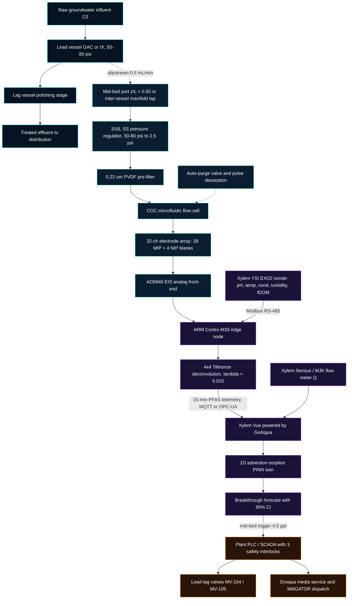
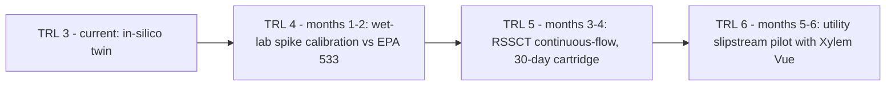

# PFAS-Sentinel™ | Mid-Bed MIP-Electrochemical Sensing & PINN Breakthrough Digital Twin

**Challenge #2: Water Quality — Xylem Global Student Innovation Challenge 2026**  
**Technology Readiness Level:** TRL 2–3 (Analytical, Numerical & Cyber-Physical In-Silico Proof-of-Concept)  
**Target Platform:** Xylem Vue powered by GoAigua (Smart Water Engine — SWE) & Evoqua Water Technologies  
**Stack:** TypeScript / React 18 / Vite / Tailwind CSS · Python 3.8+ (standard library only) · [MIT License](LICENSE)

[](#6-technology-readiness-level--in-silico-disclosure)
[](#5-regulatory-positioning--dual-threshold-strategy)
[](#5-regulatory-positioning--dual-threshold-strategy)
[](LICENSE)

---

## 1. Executive Summary

### Problem
Municipal utilities removing PFAS ("forever chemicals") with Granular Activated Carbon (GAC) or Selective Ion Exchange (IX) vessels operate with a critical blind spot:

- **Laboratory latency:** Compliance monitoring relies on centralized LC-MS/MS (US EPA Methods 533 / 537.1) with **10–14 day turnaround** and **\$300–\$500 per sample**.
- **Blind breakthrough & chromatographic roll-up:** Between sampling rounds there is no visibility into the internal Mass Transfer Zone (MTZ). Weakly adsorbed short-chain PFAS (**PFBA**, **PFBS**) break through early and can be displaced by NOM and long-chain PFAS (**PFOA**, **PFOS**), temporarily producing effluent concentrations above influent ($C_t > C_0$).
- **Premature media changeout:** To avoid violating the binding **US EPA 4.0 ppt MCL** (PFOA/PFOS) or the **EU 2026 Drinking Water Directive**, operators replace media on conservative calendar schedules — discarding an estimated **20–30% of usable adsorption capacity**.

### Solution
**PFAS-Sentinel™** is a hardware-enabled SaaS concept that combines:

1. **In-line microfluidic sensor pod** — retrofits existing `1/4" NPT` vessel sample ports (influent, mid-bed at $z/L = 0.50$, effluent) through a pressure-reducing manifold, pairing a 32-channel Molecularly Imprinted Polymer (MIP) electrochemical cartridge with **Xylem YSI EXO2** sonde telemetry.
2. **Physics-Informed Neural Network (PINN) digital twin** — designed for **Xylem Vue powered by GoAigua**, assimilating 15-minute mid-bed telemetry into a 1D advection-sorption PDE backbone to forecast effluent breakthrough weeks in advance.
3. **SCADA & servitization integration** — PLC safety interlocks gate lead-lag valve switchover and just-in-time **Evoqua** media service, with **Xylem MitiGATOR™** mobile units as contingency.

### Modeled Impact (Representative 6-Vessel Plant — see [Section 8](#8-municipal-economic--environmental-model))
| Metric | Value |
| :--- | :--- |
| Net annual utility OPEX savings | **\$112,092 / yr** |
| Media bed-life extension | **28%** |
| Spent hazardous media avoided | **15.3 t / yr** |
| Scope 3 emissions avoided | **36.7 tCO₂e / yr** |
| Disposable cartridge target BOM | **\$11.80** |
| Reusable reader pod target BOM | **\$148.00** |

> [!NOTE]
> All figures are model outputs from the in-silico twin under stated assumptions (Section 8). They are targets to be validated in TRL 4–6, not field measurements.

---

## 2. Cyber-Physical System Architecture



**Signal chain summary:** vessel sample port → pressure regulation & filtration → 32-channel MIP/NIP cartridge → AD5940 EIS → edge inversion with YSI EXO2 context → Xylem Vue PINN twin → PLC/SCADA actuation & Evoqua dispatch.

---

## 3. Mathematical Foundations

### 3.1 Governing advection-sorption PDE
Along normalized bed depth $\tilde{z} = z/L \in [0, 1]$:

$$\frac{\partial C}{\partial t} + u_{\text{MTZ}} \frac{\partial C}{\partial \tilde{z}} = S_{\text{kin}}(C), \qquad u_{\text{MTZ}} = \frac{Q\,C_0}{q_0\,M}$$

### 3.2 Thomas (Bohart-Adams) backbone

$$\frac{C_{\text{Thomas}}(\tilde{z}, t)}{C_0} = \frac{1}{1 + \exp\left( \dfrac{k_{\text{Th}}\, q_0\, M\, \tilde{z}}{Q} - k_{\text{Th}}\, C_0\, t \right)}$$

### 3.3 Hybrid PINN

$$\hat{C}(\tilde{z}, t) = C_{\text{Thomas}}(\tilde{z}, t; k_{\text{Th}}, q_0) + \mathcal{N}_{\mathbf{W}}(\tilde{z}, \tilde{t})$$

$$\mathcal{L}_{\text{PINN}} = \frac{1}{N_{\text{obs}}}\sum_{i} \left(\hat{C}(z_{\text{mid}}, t_i) - C^{\text{obs}}_{\text{mid}}(t_i)\right)^2 + \lambda_{\text{PDE}} \frac{1}{N_{\text{col}}}\sum_{j} \left(\frac{\partial \hat{C}}{\partial t} + u_{\text{MTZ}}\frac{\partial \hat{C}}{\partial \tilde{z}} - S_{\text{kin}}(\hat{C})\right)^2$$

The physical parameters $k_{\text{Th}}, q_0$ and the 2-layer residual network $\mathcal{N}_{\mathbf{W}}$ are optimized jointly (analytical backpropagation + Adam). The learned parameters directly drive the effluent trajectory and the 4.0 ppt breakthrough forecast (± 95% CI).

**Validation protocol:** temporal forward-chaining split — train on mid-bed checkpoints at days 30, 60, 90, 115, 135; evaluate on unseen days 155, 180, 210; compare against a static Thomas baseline.

### 3.4 Electrochemical inversion & deconvolution
NIP blank channels and the YSI EXO2 fDOM signal (optical NOM proxy) remove non-specific drift; cross-reactivity between C4/C8 analogs is resolved by a Tikhonov-regularized $4\times4$ inverse:

$$\hat{\mathbf{c}} = \left(\mathbf{S}^\top\mathbf{S} + \lambda\mathbf{I}\right)^{-1}\mathbf{S}^\top\,\Delta\mathbf{r}_{\text{purified}}, \qquad \lambda = 0.015,\ \kappa_2(\mathbf{S}) = 1.34,\ \det(\mathbf{S}) = 0.941$$

> [!NOTE]
> The YSI EXO2 sonde does **not** measure PFAS. It supplies matrix context (pH, temperature, conductivity, turbidity, fDOM) for compensation.

---

## 4. Hardware, Hydraulic Interfacing & Durability

| Topic | Design |
| :--- | :--- |
| **Pressure stepping** | Vessels operate at 50–80 psi. A 316L stainless regulator reduces slipstream pressure to **2.5 psi** for laminar microfluidic flow (~0.5 mL/min). |
| **Particle protection** | In-line **0.22 µm** pre-filter removes carbon fines and colloids before the flow cell. |
| **Fouling / saturation control** | Auto-purge solenoid flush plus mild electrochemical pulse desorption between measurement cycles. |
| **Cartridge service interval** | Target **30 days** per snap-in cartridge (~2,880 assays at a 15-minute cadence). |
| **Port compatibility** | (1) Mid-bed `1/4" NPT` port at $z/L = 0.50$ where available; (2) **inter-vessel manifold tap** (lead-vessel effluent) on lead-lag trains without a mid-bed port. |
| **Safety interlocks** | YSI EXO2 Modbus heartbeat watchdog · replicate CV < 10% gate · vessel ΔP < 18 psi interlock. Human-in-the-loop approval mode is supported. |

---

## 5. Regulatory Positioning & Dual-Threshold Strategy

**US EPA NPDWR (April 2024, 89 FR 32532)**
- **PFOA and PFOS: MCL 4.0 ppt** — the binding federal baseline; compliance timeline 2029–2031.
- PFHxS, PFNA, HFPO-DA (GenX): MCL 10 ppt; Hazard Index for mixtures incl. PFBS.
- EPA has announced reconsideration of parts of the rule (notably the Hazard Index and some individual limits). PFAS-Sentinel's SCADA rule layer is configurable (individual MCLs, sums, or hazard indices) without hardware changes.

**EU Drinking Water Directive (EU) 2020/2184 — applicable from January 2026**
- "Sum of 20 PFAS" ≤ 100 ng/L; "PFAS Total" ≤ 500 ng/L.

**Why PFBA / PFBS?** Short-chain C4 PFAS have lower affinity for GAC and migrate faster, so they reach the mid-bed port first. They serve as **early sentinel tracers of MTZ progression**, while PFOA/PFOS remain the compliance targets. In the in-silico benchmark, PFBA crosses 4 ppt at the mid-bed around day 89, whereas PFOA reaches 4 ppt at the effluent around day 319.

**Two thresholds, two roles**
1. **Internal SCADA trigger** — 4.0 ppt at the mid-bed port; triggers lead-lag rotation and service scheduling.
2. **Statutory limit** — MCL at final effluent; certified by retained quarterly LC-MS/MS.

---

## 6. Technology Readiness Level & In-Silico Disclosure

> [!IMPORTANT]
> PFAS-Sentinel is a **TRL 2–3 computational proof-of-concept**. Sensor signals and breakthrough observations are generated by forward numerical models; they are **not field measurements**.

- **Breakthrough data:** synthetic testbench mapped to each facility (Q, M, C0, media), shaped by digitized pilot GAC curves from *McCleaf et al. (2017)* and *Park et al. (2020)*.
- **Avoiding "inverse crime":** the forward sensor simulator (`simulatePhysicalSensorImpedance`) and the blind estimator (`predictPfasFromImpedance`) are separated. The estimator receives no ground-truth concentration or NOM value — only observable ΔR<sub>ct</sub> (MIP/NIP) and sonde telemetry. The forward model includes noise, temperature effects, and cross-binding not present in the inverse model.
- **Known limitation:** because the forward and inverse models share a modeling framework, reported accuracy (e.g., ~4.5% MAE) is an upper bound to be re-evaluated on wet-lab data.



---

## 7. Hardware Bill of Materials (Target BOM @ 10k units/yr)

**Disposable 32-channel cartridge**

| Subsystem | Component | Unit cost |
| :--- | :--- | ---: |
| Molecular recognition | Stand-alone MIP membrane (C4/C8 sub-classes) | \$4.20 |
| Transducer array | Amine-functionalized nanocarbon electrodes + Ag/AgCl | \$3.85 |
| Microfluidics & redox | COC flow cell, [Fe(CN)₆]³⁻/⁴⁻ mediator, 0.22 µm pre-filter | \$3.75 |
| **Total** | | **\$11.80** |

**Reusable reader pod (NEMA 4X)**

| Subsystem | Component | Unit cost |
| :--- | :--- | ---: |
| EIS front-end | AD5940 impedance AFE + ADG732 32:1 mux | \$28.50 |
| Edge compute & comms | ARM Cortex-M33 + NPU (Modbus / MQTT, TLS 1.3) | \$42.00 |
| Industrial fluidics | 316L micro-pump, auto-purge valve, `1/4" NPT` manifold | \$77.50 |
| **Total** | | **\$148.00** |

---

## 8. Municipal Economic & Environmental Model

Assumptions (identical to the interactive calculator in `BusinessAndPitchTab.tsx`): 6 vessels · 9.1 t media per vessel · \$85,000 media cost per vessel-year · bi-weekly LC-MS/MS at \$420/sample · 28% bed-life extension · PFAS-Sentinel fee \$14,400 per vessel-year · 2.4 tCO₂e per tonne of media avoided.

| Item | Calculation | Annual value |
| :--- | :--- | ---: |
| Baseline media OPEX | 6 × \$85,000 | \$510,000 |
| Media savings | 28% × \$510,000 | +\$142,800 |
| Baseline lab testing | 6 × 26 × \$420 | \$65,520 |
| Lab savings (quarterly LC-MS/MS retained) | 85% × \$65,520 | +\$55,692 |
| PFAS-Sentinel service fee (SaaS + cartridges) | 6 × \$14,400 | −\$86,400 |
| **Net utility savings** | | **+\$112,092** |
| Hazardous media avoided | 6 × 9.1 t × 28% | **15.3 t** |
| Scope 3 emissions avoided | 15.3 t × 2.4 | **36.7 tCO₂e** |

---

## 9. Running Locally

**Prerequisites:** Node.js 18+, npm 9+, Python 3.8+.

```bash
git clone https://github.com/YSerhatTemel/pfas-sentinel.git
cd pfas-sentinel
npm install
npm run dev      # development server
npm run build    # production bundle
```

Python PINN simulation and blind inverse EIS testbench (standard library only):

```bash
python simulation/pfas_sentinel_pinn_model.py
```

Optional scientific packages for extended analysis: `pip install -r requirements.txt`.

---

## 10. Repository Structure

```text
pfas-sentinel/
├── .github/workflows/deploy.yml     # GitHub Pages deployment
├── simulation/
│   └── pfas_sentinel_pinn_model.py  # Python PINN PDE solver & blind EIS inverse engine
├── src/
│   ├── components/
│   │   ├── AgenticEwsTab.tsx        # SCADA early warning & Evoqua dispatch
│   │   ├── BusinessAndPitchTab.tsx  # Servitization economics & ROI calculator
│   │   ├── CyberPhysicalTwinTab.tsx # Lead-lag hydraulic twin & MTZ visualization
│   │   ├── MipBiosensorTab.tsx      # 32-ch EIS, deconvolution & BOM
│   │   └── PinnBreakthroughTab.tsx  # PINN breakthrough curves & train/test split
│   ├── data/pfasPhysicsEngine.ts    # Physics engine, Tikhonov inversion, PINN
│   ├── App.tsx
│   ├── index.css
│   └── main.tsx
├── LICENSE
├── requirements.txt
├── package.json
└── README.md
```

---

## 11. References

1. US EPA. *PFAS National Primary Drinking Water Regulation*, 89 FR 32532 (April 2024).
2. Directive (EU) 2020/2184 on the quality of water intended for human consumption.
3. McCleaf, P. et al. *Water Research* 120, 77–87 (2017) — PFAS removal in GAC and anion exchange column tests.
4. Park, M. et al. *Environmental Science & Technology* 54(3), 1867–1876 (2020) — PFAS breakthrough in GAC treatment.
5. Oseyemi & Rezai (2025) — stand-alone microfluidic MIP membrane architecture.
6. AWWA — national cost analysis of the PFAS NPDWR (2024).
7. Xylem / Evoqua published municipal PFAS case studies (KKWWD, Maine; SHWSD, Colorado).

---

**Repository:** https://github.com/YSerhatTemel/pfas-sentinel · Xylem Global Student Innovation Challenge 2026 — Challenge #2: Water Quality
