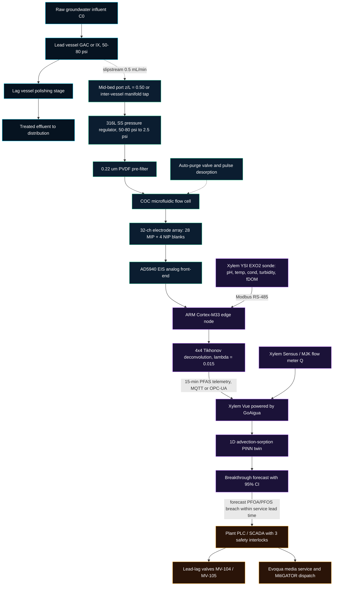
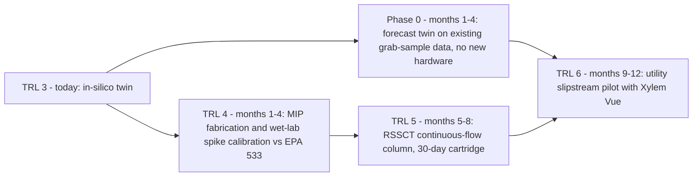

# PFAS-Sentinel™ | Mid-Bed MIP-Electrochemical Sensing & PINN Breakthrough Digital Twin

**Challenge #2: Water Quality — Xylem Global Student Innovation Challenge 2026**  
**Technology Readiness Level:** TRL 2–3 (Analytical, Numerical & Cyber-Physical In-Silico Proof-of-Concept)  
**Target Platform:** Xylem Vue powered by GoAigua (Smart Water Engine — SWE) & Evoqua Water Technologies  
**Stack:** TypeScript / React 18 / Vite / Tailwind CSS · Python 3.8+ (standard library only) · [MIT License](LICENSE)

[](#6-technology-readiness-level--in-silico-disclosure)
[](#5-regulatory-positioning--dual-threshold-strategy)
[](#5-regulatory-positioning--dual-threshold-strategy)
[](LICENSE)

**🔗 Live interactive demo:** https://yserhattemel.github.io/pfas-sentinel/ · New to the terminology? See [Key terms, explained](#key-terms-explained).

> [!NOTE]
> PFAS-Sentinel is an independent student project. It is designed for compatibility with Xylem products (Xylem Vue, YSI EXO2, Sensus, Evoqua, MitiGATOR™), but it is not developed, endorsed, or validated by Xylem Inc. All trademarks belong to their respective owners.

### How PFAS-Sentinel addresses the judging criteria
| Criterion | Where to look |
| :--- | :--- |
| **Impact** — meaningfulness & reach | Modeled savings, avoided hazardous waste and emissions, sensitivity and US market size ([Section 8](#8-municipal-economic--environmental-model)); EPA/EU compliance relevance ([Section 5](#5-regulatory-positioning--dual-threshold-strategy)) |
| **Challenge Fit & Feasibility** — Water Quality, real-world path | Retrofit onto existing vessel ports, pressure/filtration interface ([Section 4](#4-hardware-hydraulic-interfacing--durability)); honest TRL 2–3 status & 12-month roadmap with a software-first Phase 0 ([Section 6](#6-technology-readiness-level--in-silico-disclosure)) |
| **Innovation** — originality | Mid-bed PFBA/PFBS sentinel sensing + hybrid PINN breakthrough twin + 4×4 MIP/NIP deconvolution ([Sections 2–3](#2-cyber-physical-system-architecture)) |
| **Ecosystem fit** — how it plugs into Xylem | One sensor pod + one twin, wired into six existing Xylem/Evoqua offerings ([table below](#xylem-ecosystem-integration)) |

### Xylem ecosystem integration
PFAS-Sentinel adds the one missing signal (in-bed PFAS) to equipment and services Xylem already sells. Everything else it reuses.

| Xylem offering | Role in PFAS-Sentinel | Interface | Data / action |
| :--- | :--- | :--- | :--- |
| **YSI EXO2** sonde | Matrix context for the sensor inversion; it does not measure PFAS | Modbus RS-485 via the [EXO Modbus Signal Output Adapter](https://www.ysi.com/product/id-599825/EXO-Modbus-Signal-Output-Adapter) | pH, temperature, conductivity, turbidity, fDOM every 15 min |
| **Sensus / MJK** flow metering | Flow $Q$, the main driver of MTZ speed in the twin | Plant SCADA historian | Flow rate → PINN input |
| **[Xylem Vue powered by GoAigua](https://www.xylem.com/en-ie/brands/xylem-vue/smart-water-simplified/)** | Hosts the PINN twin, dashboards and the actuation rule | MQTT / OPC-UA | Breakthrough forecast ± 95% CI, alerts, audit log |
| **Evoqua** GAC / selective IX vessels | The treatment asset being monitored (lead-lag trains) | Existing `1/4" NPT` sample ports | Mid-bed and inter-vessel slipstream |
| **Evoqua** media service | Just-in-time media changeout instead of calendar-based | Work order from Xylem Vue | Service date set by forecast, not by calendar |
| **Evoqua [MitiGATOR™](https://www.xylem.com/en-uk/Catalog/products--services/services/temporary-water-treatment/mitigator-mobile-system/)** mobile system | Contingency capacity if a forecast moves suddenly (e.g. AFFF plume) | Rental dispatch | Trailer with 6 carbon/resin vessels, up to 1,000 gpm |

**Open standards, no lock-in.** Every link uses Modbus, MQTT or OPC-UA, and Xylem Vue itself ingests data from non-Xylem sources. The best fit is with Xylem equipment, but a utility with other sondes or meters can still adopt PFAS-Sentinel.

**An operator's view (representative GAC plant, in-silico timeline)**

| Day | What happens | Who / where |
| :--- | :--- | :--- |
| 0 | Fresh media; the twin starts from the Thomas prior for this facility | Xylem Vue |
| ~89 | PFBA crosses 4 ppt at the mid-bed port → **tracer alert**: the twin tightens its forecast. No valve moves. | Sensor pod → Xylem Vue notification |
| every 15 min | Pod + EXO2 telemetry assimilated; PFOA/PFOS effluent breach forecast updated | Edge node → Xylem Vue |
| ~252 | Conservative PFOA breach forecast (day ≈ 315 − 3-day CI) enters the 60-day service window → Evoqua work order raised; operator approves (or autonomous mode) | Xylem Vue → Evoqua |
| before ~315 | Lead-lag rotation; spent lead media replaced just in time | Plant PLC (3 interlocks) + Evoqua |
| quarterly | Certified LC-MS/MS confirms compliance at the effluent | Accredited lab |

---

## 1. Executive Summary

### Problem
Municipal utilities removing PFAS ("forever chemicals") with Granular Activated Carbon (GAC) or Selective Ion Exchange (IX) vessels operate with a critical blind spot:

- **Laboratory latency:** Compliance monitoring relies on centralized LC-MS/MS (US EPA Methods 533 / 537.1) with **10–14 day turnaround** and **\$300–\$500 per sample**.
- **Blind breakthrough & chromatographic roll-up:** Between sampling rounds there is no visibility into the internal Mass Transfer Zone (MTZ). Weakly adsorbed short-chain PFAS (**PFBA**, **PFBS**) break through early and can be displaced by NOM and long-chain PFAS (**PFOA**, **PFOS**), temporarily producing effluent concentrations above influent ($C_t > C_0$).
- **Premature media changeout:** To avoid violating the binding **US EPA 4.0 ppt MCL** (PFOA/PFOS) or the **EU 2026 Drinking Water Directive**, operators replace media on conservative calendar schedules — discarding an estimated **20–30% of usable adsorption capacity** (a working hypothesis to confirm in utility interviews; the business case in Section 8.1 breaks even at only 6%).

### Solution
**PFAS-Sentinel™** is a hardware-enabled SaaS concept that combines:

1. **In-line microfluidic sensor pod** — retrofits existing `1/4" NPT` vessel sample ports (influent, mid-bed at $z/L = 0.50$, effluent) through a pressure-reducing manifold, pairing a 32-channel Molecularly Imprinted Polymer (MIP) electrochemical cartridge with **Xylem YSI EXO2** sonde telemetry.
2. **Physics-Informed Neural Network (PINN) digital twin** — designed for **Xylem Vue powered by GoAigua**, assimilating 15-minute mid-bed telemetry into a 1D advection-sorption PDE backbone to forecast PFOA/PFOS effluent breakthrough months in advance.
3. **SCADA & servitization integration** — lead-lag valve switchover is scheduled from the *forecast PFOA/PFOS effluent breach*, gated by PLC safety interlocks, with just-in-time **Evoqua** media service and **Xylem MitiGATOR™** mobile units as contingency.

### Modeled Impact (Representative 6-Vessel Plant — see [Section 8](#8-municipal-economic--environmental-model))
| Metric | Value |
| :--- | :--- |
| Net annual utility OPEX savings | **\$112,092 / yr** |
| Media bed-life extension | **28%** |
| Spent hazardous media avoided | **15.3 t / yr** |
| Scope 3 emissions avoided | **36.7 tCO₂e / yr** |
| Disposable cartridge target BOM | **\$11.80** |
| Reusable reader pod target BOM | **\$148.00** |

> [!NOTE]
> All figures are model outputs from the in-silico twin under stated assumptions (Section 8). They are targets to be validated in TRL 4–6, not field measurements.

### Key terms, explained
The project uses specialist vocabulary from water treatment, electrochemistry and machine learning. Rather than drop the precise terms, each one is explained below — what it is, and why it matters for PFAS-Sentinel. The same glossary opens from the **Key Terms** button in the live demo.

**Water treatment**

| Term | What it is | Why it matters here |
| :--- | :--- | :--- |
| **PFAS (short-chain C4 vs long-chain C8)** | Per- and polyfluoroalkyl substances, "forever chemicals". The number is the length of the carbon chain: PFBA/PFBS have 4 carbons, PFOA/PFOS have 8. | Short chains stick to carbon weakly and move through the filter first; long chains stick strongly and are the ones the US limit (4 ppt) targets. |
| **GAC / Selective IX** | Granular activated carbon and selective ion-exchange resin: the two main media used in pressure vessels to remove PFAS from drinking water. | Both get "used up" over time and must be replaced; replacing too early wastes money and creates hazardous waste. |
| **Lead-lag train** | Two vessels in series. The lead vessel does most of the work; the lag vessel polishes and acts as a safety barrier. | When the lead vessel is spent, valves swap the roles and only the lead media is replaced. Timing this swap is the decision PFAS-Sentinel supports. |
| **Mid-bed port (z/L = 0.50)** | A sampling tap halfway down the vessel. z is the depth from the top, L the total bed depth, so z/L = 0.50 is the middle. | Contaminants reach the middle months before the outlet, so a reading here is an early look at what the outlet will see later. |
| **Mass Transfer Zone (MTZ)** | The band of media that is actively adsorbing. Above it the media is saturated; below it the media is still clean. | The MTZ moves down the bed like a slow wave. Tracking its position is what lets the twin forecast when the outlet will exceed the limit. |
| **Breakthrough & Bed Volumes (BV)** | Breakthrough is when a contaminant starts appearing at the outlet. One bed volume is the amount of water equal to the volume of the media bed. | Bed volumes let results from columns of different sizes be compared; the literature reports PFAS breakthrough in BV. |
| **Chromatographic roll-up (Cₜ > C₀)** | Strongly held long-chain PFAS push weakly held short-chain PFAS back off the carbon, so the outlet can briefly carry more short-chain PFAS than the inlet. | Grab samples taken every few weeks can miss these spikes completely; continuous mid-bed data can see them coming. |
| **MCL / Hazard Index** | Maximum Contaminant Level: the legal limit in drinking water (4.0 ppt for PFOA and PFOS in the US). The Hazard Index is a combined score for a PFAS mixture. | EPA plans to keep the PFOA/PFOS MCLs and rescind the Hazard Index, so PFOA/PFOS are the targets that drive actuation in this design. |
| **LC-MS/MS (EPA Method 533 / 537.1)** | Liquid chromatography with tandem mass spectrometry: the certified laboratory method for measuring PFAS at parts-per-trillion levels. | It is accurate but slow (10–14 days) and costly ($300–$500 per sample). PFAS-Sentinel keeps it for quarterly compliance but adds continuous data in between. |
| **RSSCT** | Rapid Small-Scale Column Test: a lab column filled with crushed media that reproduces months of full-scale operation in days or weeks. | It is the planned TRL 5 step for testing the sensor cartridge and the twin on real breakthrough curves without a full-scale plant. |

**Sensor**

| Term | What it is | Why it matters here |
| :--- | :--- | :--- |
| **MIP / NIP** | A molecularly imprinted polymer has cavities shaped like the target molecule, so PFAS fit in and most other molecules do not. A non-imprinted polymer (NIP) is the same material without the cavities. | The NIP picks up everything except specific PFAS binding, so subtracting NIP from MIP removes background signal from organic matter and salts. |
| **EIS & ΔRct** | Electrochemical impedance spectroscopy measures how easily charge passes through the electrode surface. Rct is the charge-transfer resistance. | When PFAS fill the MIP cavities they block a redox probe, Rct rises, and that change (ΔRct) is converted into a concentration. |
| **4×4 Tikhonov deconvolution** | A matrix calculation that separates four overlapping signals (PFBA, PFBS, PFOA, PFOS), because each sensor channel responds a little to all four. Tikhonov regularization keeps the answer stable when the data is noisy. | Without it, a high PFOS level could be misread as PFOA, which would distort the forecast. |
| **fDOM / NOM** | Natural organic matter (NOM) is dissolved material from soil and plants. fDOM is its fluorescent part, measured optically by the YSI EXO2 sonde. | NOM competes with PFAS for carbon and fouls sensors; the fDOM reading lets both the sensor and the twin correct for it. |
| **Debye length** | The thin layer near a charged surface where ions in the water screen the charge (Gouy-Chapman theory). It shrinks as the water gets saltier. | It changes how strongly charged PFAS are attracted to the electrode, so the edge inversion corrects for conductivity. |

**Digital twin & business**

| Term | What it is | Why it matters here |
| :--- | :--- | :--- |
| **PINN / physics-guided hybrid twin** | A physics-informed neural network combines a physical equation (here, the 1D advection-sorption model of the moving MTZ) with a small neural network that learns the corrections physics misses. | Physics keeps forecasts sensible with very little data; the network adapts to each plant. Our version uses an approximate gradient for the physics term, so we call it PINN-style. |
| **95% confidence interval (CI)** | The range of days within which the predicted breakthrough is expected to fall 95% of the time. | Actuation uses the early end of the range (breach day minus CI), so uncertainty makes the system more cautious, not less. |
| **Agentic early warning system (EWS)** | A chain of software steps that reads data, forecasts, decides and prepares actions (valve swap, service order) — with human sign-off or interlocks before anything moves. | It turns a forecast into a scheduled action instead of a chart someone must remember to check. |
| **Servitization** | Selling an outcome as a service (here a per-vessel subscription with cartridges included) instead of selling equipment up front. | Utilities avoid capital cost and pay from the media savings; Xylem gains recurring revenue alongside Evoqua media service. |
| **TRL (Technology Readiness Level)** | A 1–9 scale of maturity: TRL 3 is a proof of concept, TRL 4 lab validation, TRL 5 validation in a relevant environment, TRL 6 a prototype demonstrated in that environment. | PFAS-Sentinel is at TRL 2–3 (simulation); the 12-month roadmap targets TRL 6. |

---

## 2. Cyber-Physical System Architecture



**Signal chain summary:** vessel sample port → pressure regulation & filtration → 32-channel MIP/NIP cartridge → AD5940 EIS → edge inversion with YSI EXO2 context → Xylem Vue PINN twin → PLC/SCADA actuation & Evoqua dispatch.

---

## 3. Mathematical Foundations

### 3.1 Governing advection-sorption PDE
Along normalized bed depth $\tilde{z} = z/L \in [0, 1]$:

$$\frac{\partial C}{\partial t} + u_{\text{MTZ}} \frac{\partial C}{\partial \tilde{z}} = S_{\text{kin}}(C), \qquad u_{\text{MTZ}} = \frac{Q\,C_0}{q_0\,M}$$

### 3.2 Thomas (Bohart-Adams) backbone

$$\frac{C_{\text{Thomas}}(\tilde{z}, t)}{C_0} = \frac{1}{1 + \exp\left( \dfrac{k_{\text{Th}}\, q_0\, M\, \tilde{z}}{Q} - k_{\text{Th}}\, C_0\, t \right)}$$

### 3.3 Hybrid PINN

$$\hat{C}(\tilde{z}, t) = C_{\text{Thomas}}(\tilde{z}, t; k_{\text{Th}}, q_0) + \mathcal{N}_{\mathbf{W}}(\tilde{z}, \tilde{t})$$

$$\mathcal{L}_{\text{PINN}} = \frac{1}{N_{\text{obs}}}\sum_{i} \left(\hat{C}(z_{\text{mid}}, t_i) - C^{\text{obs}}_{\text{mid}}(t_i)\right)^2 + \lambda_{\text{PDE}} \frac{1}{N_{\text{col}}}\sum_{j} \left(\frac{\partial \hat{C}}{\partial t} + u_{\text{MTZ}}\frac{\partial \hat{C}}{\partial \tilde{z}} - S_{\text{kin}}(\hat{C})\right)^2$$

The physical parameters $k_{\text{Th}}, q_0$ and the 2-layer residual network $\mathcal{N}_{\mathbf{W}}$ are optimized jointly with Adam. The data term uses exact analytical backpropagation; the PDE term is a finite-difference residual at collocation points penalized with an approximate (surrogate) gradient rather than full automatic differentiation, so the model is best described as a *physics-guided hybrid* (PINN-style) rather than a textbook PINN. The learned parameters drive the effluent trajectory and the 4.0 ppt breakthrough forecast (± 95% CI).

**Validation protocol:** temporal forward-chaining split — train on mid-bed checkpoints at days 30, 60, 90, 115, 135; evaluate on unseen days 155, 180, 210; compare against a static Thomas baseline scored on the **same** unseen days.

| Analyte | Hybrid model test RMSE (ppt) | Static Thomas test RMSE (ppt) |
| :--- | ---: | ---: |
| PFBA | 0.31 | 0.61 |
| PFBS | 0.75 | 1.90 |
| PFOA | 1.49 | 6.21 |
| PFOS | 0.68 | 7.15 |

*Output of `python simulation/pfas_sentinel_pinn_model.py` (in-silico; see Section 6).*

### 3.4 Electrochemical inversion & deconvolution
NIP blank channels and the YSI EXO2 fDOM signal (optical NOM proxy) remove non-specific drift; cross-reactivity between C4/C8 analogs is resolved by a Tikhonov-regularized $4\times4$ inverse:

$$\hat{\mathbf{c}} = \left(\mathbf{S}^\top\mathbf{S} + \lambda\mathbf{I}\right)^{-1}\mathbf{S}^\top\,\Delta\mathbf{r}_{\text{purified}}, \qquad \lambda = 0.015,\ \kappa_2(\mathbf{S}) = 1.34,\ \det(\mathbf{S}) = 0.941$$

> [!NOTE]
> The YSI EXO2 sonde does **not** measure PFAS. It supplies matrix context (pH, temperature, conductivity, turbidity, fDOM) for compensation.

---

## 4. Hardware, Hydraulic Interfacing & Durability

| Topic | Design |
| :--- | :--- |
| **Pressure stepping** | Vessels operate at 50–80 psi. A 316L stainless regulator reduces slipstream pressure to **2.5 psi** for laminar microfluidic flow (~0.5 mL/min). |
| **Particle protection** | In-line **0.22 µm** pre-filter removes carbon fines and colloids before the flow cell. |
| **Fouling / saturation control** | Auto-purge solenoid flush plus mild electrochemical pulse desorption between measurement cycles. |
| **Cartridge service interval** | Target **30 days** per snap-in cartridge (~2,880 assays at a 15-minute cadence). |
| **Port compatibility** | (1) Mid-bed `1/4" NPT` port at $z/L = 0.50$ where available; (2) **inter-vessel manifold tap** (lead-vessel effluent) on lead-lag trains without a mid-bed port. |
| **Safety interlocks** | YSI EXO2 Modbus heartbeat watchdog · replicate CV < 10% gate · vessel ΔP < 18 psi interlock. Human-in-the-loop approval mode is supported. |

---

## 5. Regulatory Positioning & Dual-Threshold Strategy

**US EPA NPDWR (April 2024, 89 FR 32532)**
- **PFOA and PFOS: MCL 4.0 ppt** — the binding federal baseline; compliance timeline 2029–2031.
- PFHxS, PFNA, HFPO-DA (GenX): MCL 10 ppt; Hazard Index for mixtures incl. PFBS.
- **Regulatory update:** in May 2025 EPA announced it will **keep the 4.0 ppt PFOA/PFOS MCLs**, extend their compliance deadline from 2029 to 2031, and rescind the PFHxS, PFNA, HFPO-DA and Hazard Index limits; the corresponding proposed rules followed. PFOA/PFOS are therefore the most durable compliance targets, which is why they alone drive actuation. The SCADA rule layer is software-configurable (individual MCLs, sums, hazard indices) if the rules change again.

**EU Drinking Water Directive (EU) 2020/2184 — applicable from January 2026**
- "Sum of 20 PFAS" ≤ 100 ng/L; "PFAS Total" ≤ 500 ng/L.

**Why PFBA / PFBS?** Short-chain C4 PFAS have lower affinity for GAC and migrate faster, so they reach the mid-bed port first. They serve as **early tracers of MTZ progression** that feed the twin with data months before PFOA/PFOS move, while PFOA/PFOS remain the compliance targets. In the in-silico benchmark, PFBA crosses 4 ppt at the mid-bed around day 89, whereas PFOA reaches 4 ppt at the effluent around day 319.

> [!IMPORTANT]
> A C4 tracer alert **never actuates media changeout on its own.** Switching the lead vessel on day 89 would discard ~230 days of PFOA/PFOS capacity — exactly the premature changeout PFAS-Sentinel is meant to prevent.

**Three signals, three roles**
1. **MTZ tracer alert** — PFBA/PFBS reach 4.0 ppt at the mid-bed port; operator notification and forecast refinement only, no actuation.
2. **Actuation trigger** — the twin's forecast PFOA/PFOS effluent breach day (minus its 95% CI) falls inside the media service lead time; schedules lead-lag rotation and Evoqua service.
3. **Statutory limit** — MCL at final effluent; certified by retained quarterly LC-MS/MS.

Where a utility also targets short-chain species (e.g. under the EU Sum-of-20), the actuation rule can be reconfigured to include them, since the rule layer is software-defined.

---

## 6. Technology Readiness Level & In-Silico Disclosure

> [!IMPORTANT]
> PFAS-Sentinel is a **TRL 2–3 computational proof-of-concept**. Sensor signals and breakthrough observations are generated by forward numerical models; they are **not field measurements**.

- **Breakthrough data:** synthetic testbench mapped to each facility (Q, M, C0, media), shaped by digitized pilot GAC curves from *McCleaf et al. (2017)* and *Park et al. (2020)*.
- **Facility profiles are representative, not utility data.** The KKWWD (lead-lag GAC) and Stratmoor Hills (selective IX) profiles are inspired by published Xylem/Evoqua case studies, but flows, media masses and influent levels are illustrative assumptions; the EU hybrid profile is hypothetical.
- **Avoiding "inverse crime":** the forward sensor simulator (`simulatePhysicalSensorImpedance`) and the blind estimator (`predictPfasFromImpedance`) are separated. The estimator receives no ground-truth concentration or NOM value — only observable ΔR<sub>ct</sub> (MIP/NIP) and sonde telemetry. The forward model includes noise, temperature effects, and cross-binding not present in the inverse model.
- **Known limitation:** because the forward and inverse models share a modeling framework, reported accuracy (≈2% mean absolute error across the 5-matrix benchmark, computed live in the app; up to ~11% for single low-concentration readings near 0.2 ppt in the Python testbench) is an optimistic bound to be re-evaluated on wet-lab data.

### 12-month validation roadmap (two parallel tracks)



- **Phase 0 (software-first).** Utilities already collect periodic mid-bed and effluent grab samples for LC-MS/MS. The twin is built to learn from this kind of sparse data — the current model is trained on only five mid-bed checkpoints (days 30, 60, 90, 115, 135). Running it on a partner utility's historical records in a Xylem Vue sandbox tests the forecasting value **before any sensor exists**, and gives a fallback product if the sensor track slips.
- **Sensor track (TRL 4 → 6).** Each stage has a go/no-go measure: limit of detection and cross-selectivity against EPA Method 533 (TRL 4), 30-day cartridge stability in a rapid small-scale column test (TRL 5), and measured media-life extension at a utility slipstream (TRL 6; modeled 28%, break-even 6%).

---

## 7. Hardware Bill of Materials (Target BOM @ 10k units/yr)

**Disposable 32-channel cartridge**

| Subsystem | Component | Unit cost |
| :--- | :--- | ---: |
| Molecular recognition | Stand-alone MIP membrane (C4/C8 sub-classes) | \$4.20 |
| Transducer array | Amine-functionalized nanocarbon electrodes + Ag/AgCl | \$3.85 |
| Microfluidics & redox | COC flow cell, [Fe(CN)₆]³⁻/⁴⁻ mediator, 0.22 µm pre-filter | \$3.75 |
| **Total** | | **\$11.80** |

**Reusable reader pod (NEMA 4X)**

| Subsystem | Component | Unit cost |
| :--- | :--- | ---: |
| EIS front-end | AD5940 impedance AFE + ADG732 32:1 mux | \$28.50 |
| Edge compute & comms | ARM Cortex-M33 + NPU (Modbus / MQTT, TLS 1.3) | \$42.00 |
| Industrial fluidics | 316L micro-pump, auto-purge valve, `1/4" NPT` manifold | \$77.50 |
| **Total** | | **\$148.00** |

---

## 8. Municipal Economic & Environmental Model

Assumptions (identical to the interactive calculator in `BusinessAndPitchTab.tsx`): 6 vessels · 9.1 t media per vessel · \$85,000 media cost per vessel-year · bi-weekly LC-MS/MS at \$420/sample · 28% bed-life extension · PFAS-Sentinel fee \$14,400 per vessel-year · 2.4 tCO₂e per tonne of media avoided.

| Item | Calculation | Annual value |
| :--- | :--- | ---: |
| Baseline media OPEX | 6 × \$85,000 | \$510,000 |
| Media savings | 28% × \$510,000 | +\$142,800 |
| Baseline lab testing | 6 × 26 × \$420 | \$65,520 |
| Lab savings (quarterly LC-MS/MS retained) | 85% × \$65,520 | +\$55,692 |
| PFAS-Sentinel service fee (SaaS + cartridges) | 6 × \$14,400 | −\$86,400 |
| **Net utility savings** | | **+\$112,092** |
| Hazardous media avoided | 6 × 9.1 t × 28% | **15.3 t** |
| Scope 3 emissions avoided | 15.3 t × 2.4 | **36.7 tCO₂e** |

### 8.1 Sensitivity: how much depends on the 28% assumption?
The 28% bed-life extension sits inside the 20–30% capacity typically discarded by calendar-based changeout (Section 1), but it is not yet measured. The table shows net annual savings for the same 6-vessel plant when that assumption, and the baseline lab frequency, are varied:

| Bed-life extension | Net savings, bi-weekly lab baseline | Net savings, monthly lab baseline | Media avoided |
| :--- | ---: | ---: | ---: |
| 10% | +\$20,292 | −\$9,696 | 5.5 t |
| 20% | +\$71,292 | +\$41,304 | 10.9 t |
| **28% (base case)** | **+\$112,092** | **+\$82,104** | **15.3 t** |
| 35% | +\$147,792 | +\$117,804 | 19.1 t |

**Break-even:** 6.0% bed-life extension with a bi-weekly lab baseline, 11.9% with a monthly one. The business case therefore survives even if field results come in at well under half the modeled extension. Per vessel: net = $85{,}000\,e + 0.85 \times n_{\text{lab}} \times \$420 - \$14{,}400$, where $e$ is the extension and $n_{\text{lab}}$ is the number of baseline samples per year.

### 8.2 Market opportunity
| Layer | Estimate | Basis |
| :--- | :--- | :--- |
| Systems covered by the US rule | ~66,000 public water systems | US EPA, April 2024 |
| Systems expected to need treatment | ~6–10% → **~4,000–6,600 systems** | US EPA, April 2024 |
| National compliance spend | \$1.5 B/yr (EPA) to \$2.7–3.5 B/yr (AWWA 2024 update); \$37–48 B capital over 5 years (AWWA) | EPA final rule; AWWA / Black & Veatch / Corona Environmental |
| PFAS-Sentinel addressable revenue (US) | **~\$115 M–\$570 M/yr** | 4,000–6,600 systems × 2–6 vessels × \$14,400 per vessel-year |

The upper bound assumes every treating system adopts it; the realistic initial segment is mid-size groundwater utilities running GAC/IX lead-lag trains, where the per-vessel savings above clearly exceed the fee. Small single-well systems may need a lower-cost tier. EU Member States (Sum-of-20 from January 2026) and other markets with PFAS limits are additional upside not counted here.

---

## 9. Running Locally

**Prerequisites:** Node.js 18+, npm 9+, Python 3.8+.

```bash
git clone https://github.com/YSerhatTemel/pfas-sentinel.git
cd pfas-sentinel
npm install
npm run dev      # development server
npm run build    # production bundle
```

Python PINN simulation and blind inverse EIS testbench (standard library only):

```bash
python simulation/pfas_sentinel_pinn_model.py
```

Optional scientific packages for extended analysis: `pip install -r requirements.txt`.

---

## 10. Repository Structure

```text
pfas-sentinel/
├── .github/workflows/deploy.yml     # GitHub Pages deployment
├── simulation/
│   └── pfas_sentinel_pinn_model.py  # Python PINN PDE solver & blind EIS inverse engine
├── src/
│   ├── components/
│   │   ├── AgenticEwsTab.tsx        # SCADA early warning & Evoqua dispatch
│   │   ├── BusinessAndPitchTab.tsx  # Servitization economics & ROI calculator
│   │   ├── CyberPhysicalTwinTab.tsx # Lead-lag hydraulic twin & MTZ visualization
│   │   ├── MipBiosensorTab.tsx      # 32-ch EIS, deconvolution & BOM
│   │   └── PinnBreakthroughTab.tsx  # PINN breakthrough curves & train/test split
│   ├── data/pfasPhysicsEngine.ts    # Physics engine, Tikhonov inversion, PINN
│   ├── App.tsx
│   ├── index.css
│   └── main.tsx
├── LICENSE
├── requirements.txt
├── package.json
└── README.md
```

---

## 11. References

1. US EPA. *PFAS National Primary Drinking Water Regulation*, 89 FR 32532 (April 2024).
2. Directive (EU) 2020/2184 on the quality of water intended for human consumption.
3. McCleaf, P., Englund, S., Östlund, A., et al. (2017). Removal efficiency of multiple PFASs in drinking water using GAC and anion exchange column tests. *Water Research* 120, 77–87. https://doi.org/10.1016/j.watres.2017.04.057
4. Park, M., Wu, S., Lopez, I. J., et al. (2020). Adsorption of PFAS in groundwater by granular activated carbons: Roles of hydrophobicity of PFAS and carbon characteristics. *Water Research* 170, 115364. https://doi.org/10.1016/j.watres.2019.115364
5. Oseyemi, A. E., & Rezai, P. (2026). Detection of perfluorooctanoic acid in water using a microfluidic electrochemical sensor with a molecularly imprinted polymer membrane. *Measurement Science and Technology* 37, 415108. Preprint (2025): https://doi.org/10.26434/chemrxiv-2025-m27j4
6. AWWA (2024). Updated national cost estimate for the PFAS NPDWR, prepared with Corona Environmental and Black & Veatch — \$2.7–3.5 B/yr annualized; \$37.1–48.3 B capital over 5 years. Summary: https://asdwa.org/2024/08/02/awwa-releases-updated-national-pfas-cost-estimate
7. US EPA (2024). *PFAS NPDWR Fact Sheet: Costs and Benefits*. https://www.epa.gov/system/files/documents/2024-04/pfas-npdwr_fact-sheet_cost-and-benefits_4.8.24.pdf
8. Xylem. *Kennebunkport removes PFOA and PFOS from contaminated well* (KKWWD, Maine; lead-lag GAC). https://www.xylem.com/en-ie/resources/case-studies/kennebunkport-removes-pfoa-and-pfos-from-contaminated-well/
9. Xylem. *PFOA/PFOS removed from municipal water well* (Stratmoor Hills, Colorado; selective single-use IX). https://www.xylem.com/en-lv/resources/case-studies/pfoapfos-removed-from-municipal-water-well/
10. Xylem / Evoqua. *MitiGATOR™ Mobile System* (rental temporary treatment). https://www.xylem.com/en-uk/Catalog/products--services/services/temporary-water-treatment/mitigator-mobile-system/
11. YSI, a Xylem brand. *EXO Modbus Signal Output Adapter*. https://www.ysi.com/product/id-599825/EXO-Modbus-Signal-Output-Adapter
12. US EPA (May 2025). Announcement to keep PFOA/PFOS MCLs, extend compliance to 2031 and rescind PFHxS, PFNA, HFPO-DA and Hazard Index limits. Coverage: https://waterworld.com/water-utility-management/press-release/55290302/epa-announces-it-will-keep-maximum-contaminant-levels-for-pfoa-and-pfos
13. 2witech Solutions. Portable MIP-electrochemical PFAS screening device (NIEHS SRP, SBIR R43ES035347). https://www.niehs.nih.gov/research/supported/centers/srp/science_digest/2024/6/technology
14. Verralize. Portable nanocarbon electrochemical PFAS sensor (company-reported 4 ppt in 12–15 min). https://www.innovationnewsnetwork.com/partner/verralizes-portable-sensor-delivers-lab-quality-pfas-detection/
15. Rowan University (2025). NSF backs research on low-cost sensor to detect PFAS in water. https://today.rowan.edu/news/2025/10/nsf-backs-research-on-low-cost-sensor-to-detect-pfas-in-water.html

---

**Repository:** https://github.com/YSerhatTemel/pfas-sentinel · Xylem Global Student Innovation Challenge 2026 — Challenge #2: Water Quality
